<picture>
  <source media="(prefers-color-scheme: dark)" srcset="./static/local-operator-icon-2-dark-clear.png">
  <source media="(prefers-color-scheme: light)" srcset="./static/local-operator-icon-2-light-clear.png">
  
</picture>

<h1 align="center">Local Operator</h1>

<p align="center"><b>An open-source AI agent hub: organizations of collaborating agents that run on your own machine, around the clock.</b></p>

<p align="center">
  <a href="https://pypi.org/project/local-operator/"></a>
  <a href="./LICENSE"></a>
  <a href="https://github.com/damianvtran/local-operator-ui/releases/latest"></a>
</p>

**Local Operator** is the runtime that hosts, supervises and connects your
agents. One session plans its work, runs tools, browses and remembers what it
did. Give it a team and it becomes a manager that delegates to
tool-restricted workers, messages sibling sessions in other repos, schedules
its own follow-ups and picks them back up after you close the terminal. It
runs on your machine, asks before it writes or executes, draws on the ChatGPT,
Claude, Kimi, Grok, Z.AI and Qwen subscriptions you already pay for, and is
MIT licensed.

## Get it

| Surface | Where |
| --- | --- |
| **Desktop app** (macOS, Windows, Linux) | [Latest release](https://github.com/damianvtran/local-operator-ui/releases/latest) (always the newest build) · [project website](https://local-operator.com/download) · or via npm, [below](#install-the-desktop-app-from-npm) |
| **Terminal UI (TUI)** (macOS, Linux, Windows) | One-line installer, [below](#install-the-terminal-ui) |
| **Phone** | [`lop mobile`](#phone-access) web relay, available now · native [iOS/Android app](https://github.com/damianvtran/local-operator-mobile) **in development**, not yet in any app store |
| **Browser extension** | [Chrome Web Store](https://chromewebstore.google.com/detail/local-operator/omibaecbjdhgbbcedbnnnmjpmopfheof): let agents drive the Chromium browser you already use |

### Install the desktop app from npm

```bash
npx local-operator-ui
```

### Install the terminal UI

No Python needed: the installers use [uv](https://docs.astral.sh/uv/), which
brings Python 3.12+.

macOS / Linux:

```bash
curl -LsSf https://raw.githubusercontent.com/damianvtran/local-operator/main/scripts/install.sh | sh
```

Windows (PowerShell):

```powershell
powershell -ExecutionPolicy ByPass -c "irm https://raw.githubusercontent.com/damianvtran/local-operator/main/scripts/install.ps1 | iex"
```

With a package manager:

```bash
uv tool install local-operator    # or: pipx install local-operator
```

## Quickstart

```bash
lop                  # opens the setup screen
/login radient       # recommended: one browser sign-in, many models, no API key needed
```

`/login` also lists every subscription (ChatGPT, Claude, SuperGrok, Kimi, Z.AI),
API key (OpenAI, Anthropic, xAI, Google, DeepSeek, OpenRouter, Mistral, Qwen)
and local server (LM Studio, Ollama, vLLM, llama.cpp). After sign-in **Aida**,
your chief of staff, says hello and helps you set up your first agents and
teams. `esc` stops the agent, `/help` lists commands, `lop update` upgrades.

<p align="center">
  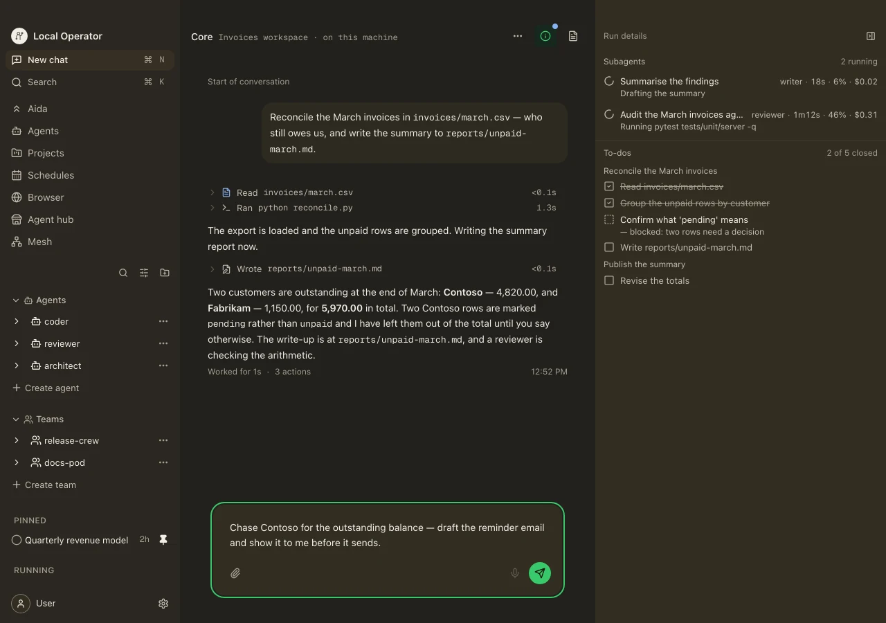
</p>
<p align="center"><i>Desktop app</i></p>

<p align="center">
  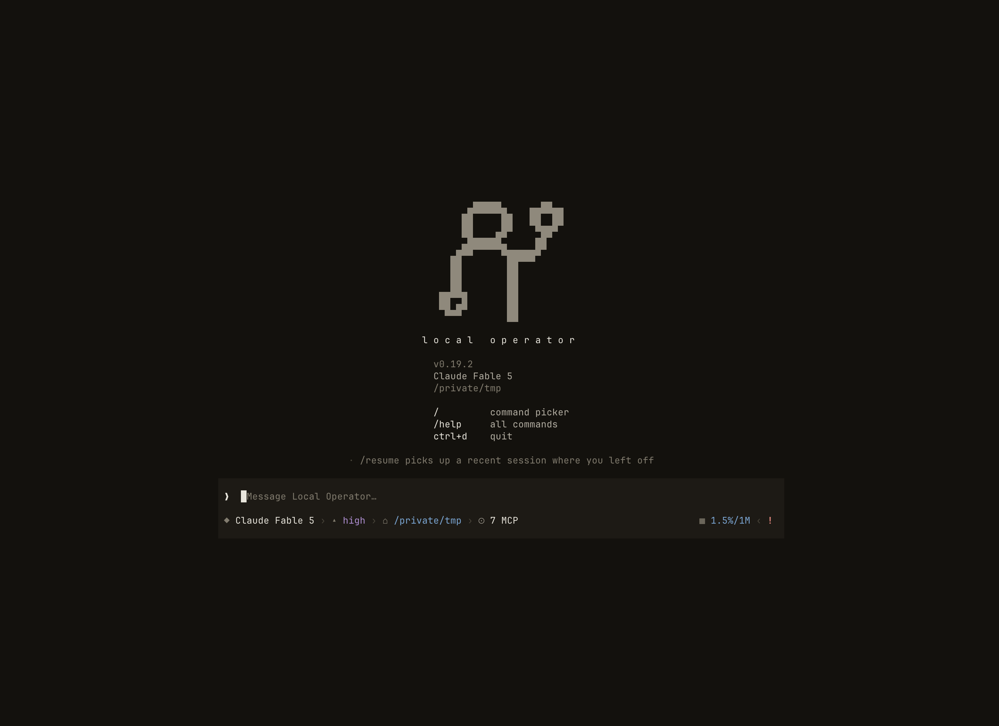
</p>
<p align="center"><i>Terminal UI (TUI)</i></p>

More → [getting started](docs/guide/getting-started.md) (plain `pip`,
local models, first-run details) · [why Local Operator](docs/guide/overview.md)

**Sections:**
[Desktop app](#desktop-app) ·
[Agent organizations](#agent-organizations) ·
[Agent mesh](#agent-mesh) ·
[Always on](#always-on) ·
[Phone access](#phone-access) ·
[Subscriptions and providers](#subscriptions-and-providers) ·
[Terminal UI](#terminal-ui) ·
[Safety](#safety-model)

## Desktop app

The desktop app, [Local Operator UI](https://github.com/damianvtran/local-operator-ui),
drives the same sessions, teams, schedules and configuration as the TUI, and
adds what a terminal cannot draw:

- a Chromium **browser pane** the agent can drive, with approval before it acts on a page;
- a **file canvas** for markdown, code, HTML, images, PDFs, spreadsheets, audio and video;
- **pages** for agents, teams, projects, schedules, the Agent Hub, the mesh and settings, behind a command palette.

The app bundles its own backend (or uses an existing `lop` install). It checks
GitHub Releases for new versions and installs one when you confirm.

<p align="center">
  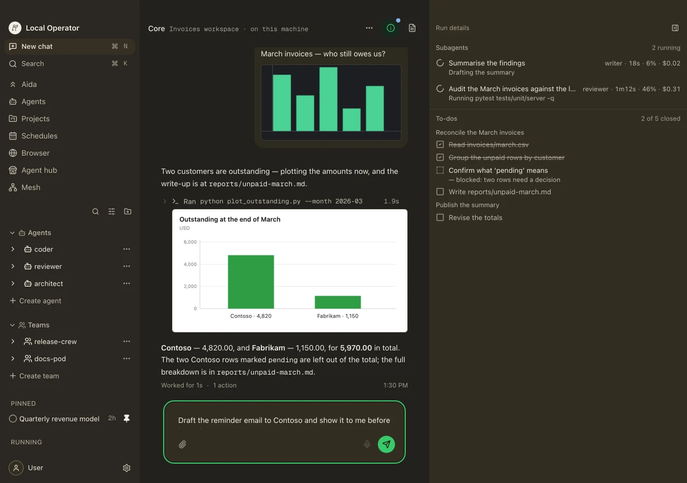
</p>

More → [desktop app guide](docs/guide/desktop-app.md)

## Agent organizations

- **Subagents** fan parallel work out into background workers; a live dock
  shows each worker's status, spend and progress.
- **Roles are capability boundaries**: a `reviewer` keeps read and test access
  but loses the tools to edit what it reviews, and the restriction is
  inherited at any depth. Starter roles (`reviewer`, `coder`, `architect`,
  `manager`, `designer`, `scout`, `ux-reviewer`, …) ship in the package.
- **Teams** are saved rosters (a manager plus members) with a *collaboration*
  brief and a *project* brief; swap the project brief to staff a different
  product. Teams nest; `/team chart <name>` draws the org chart.
- `/team <name> <request>` hands a request to a team; `lop agents` and
  `lop teams` manage them from a shell.

<p align="center">
  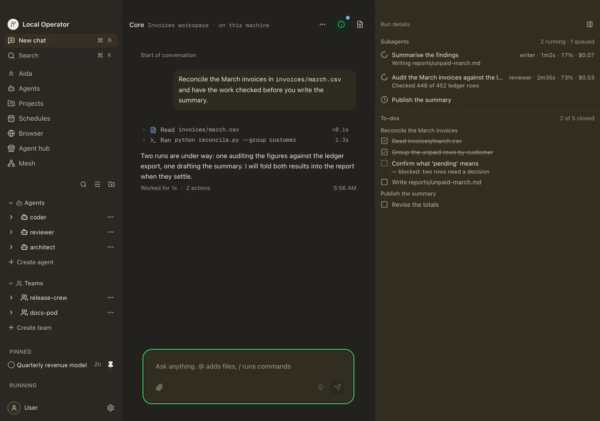
</p>

<p align="center">
  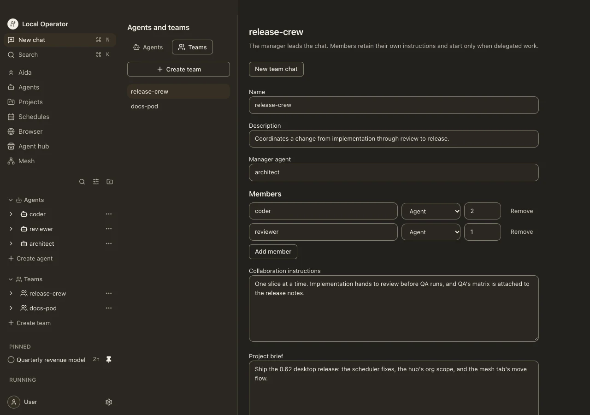
</p>

More → [organizations guide](docs/guide/organizations.md#agent-organizations) ·
[agents](local_operator/guides/agents/GUIDE.md) · [teams](local_operator/guides/teams/GUIDE.md)

## Cross-agent messaging

A manager peeks at, questions, steers, pauses and resumes its workers through
`hub`. Independent sessions in different repos message each other with `send`
(`lop send` from a shell): leave a note, wake an idle peer, or redirect one
mid-turn. Every delivery leaves a receipt on both ends; it is loopback only and
bounded by your OS account.

```bash
lop sessions                                              # every session on this machine
lop send "release cutter" --wake "the deploy finished; verify prod"
```

More → [cross-agent communication](docs/guide/organizations.md#cross-agent-communication) ·
[peer-messaging guide](local_operator/guides/peer-messaging/GUIDE.md)

## Agent mesh

`lop network` pairs your own machines into a peer-to-peer **mesh**: their
sessions appear in one sidebar, and you can start, move, warm or stop a session
on another device without leaving yours. Pairing is a single-use token plus a
code two people compare on two screens; logins are brokered, not copied.

```bash
lop network init devmesh && lop network invite --role drive   # on the owning device
lop network join @/path/to/token                              # on the other device
```

<p align="center">
  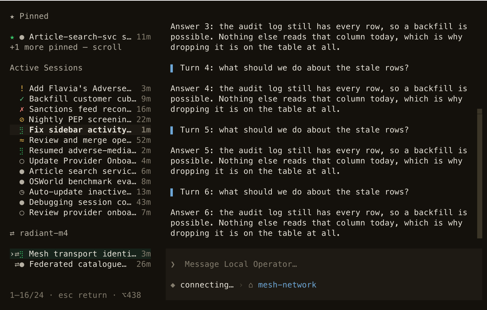
</p>

More → [mesh walkthrough](docs/guide/mesh.md) · [network guide](local_operator/guides/network/GUIDE.md)

## Always on

- **Wakes** schedule future turns and persist; on macOS a wake supervisor fires
  them even after the terminal is closed (`lop wake status`).
- **Background jobs** (`task`, `bash background=true`) report back on their
  own; `wait` blocks until something settles instead of polling.
- `lop exec --background` detaches a whole task; paused subagents resume
  after a restart.
- The **mobile daemon** keeps every session reachable from your phone.

<p align="center">
  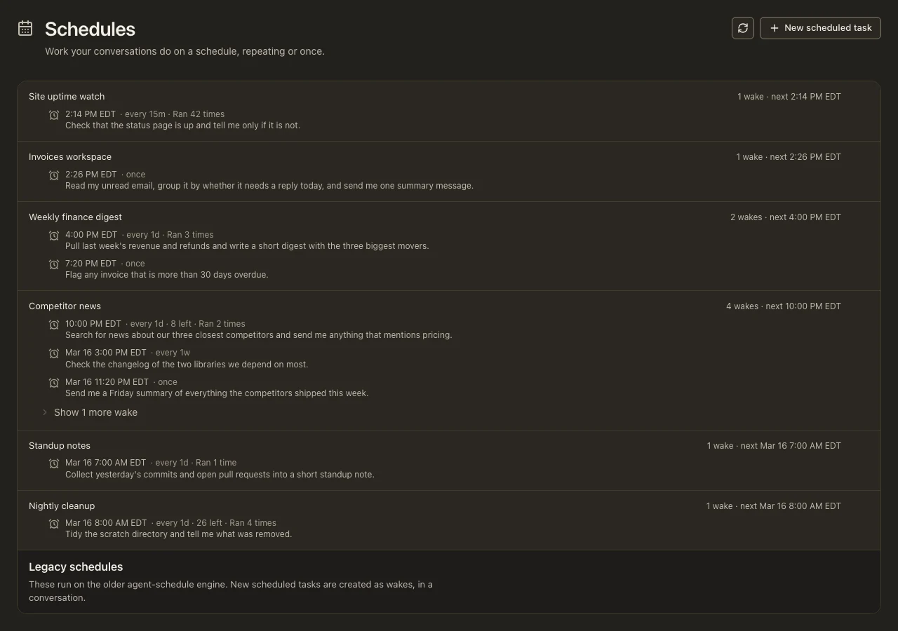
</p>

More → [always-on guide](docs/guide/always-on.md)

## Phone access

`lop mobile install` runs a supervised daemon that serves a phone web client
for every `lop` session on the machine: watch transcripts stream, steer a
turn, switch model, run slash commands, drill into subagents and start new
sessions. It binds loopback only; reach it remotely through a
[Cloudflare Tunnel](https://developers.cloudflare.com/cloudflare-one/networks/connectors/cloudflare-tunnel/)
with Access, or [Tailscale](https://tailscale.com/). Or just ask the agent to
*"set up phone access"*.

The native [Local Operator Mobile](https://github.com/damianvtran/local-operator-mobile)
app for iOS and Android talks to the same relay. It is **in development**: no
build is published in any app store yet.

<table width="100%">
  <tr>
    <td align="center" valign="top">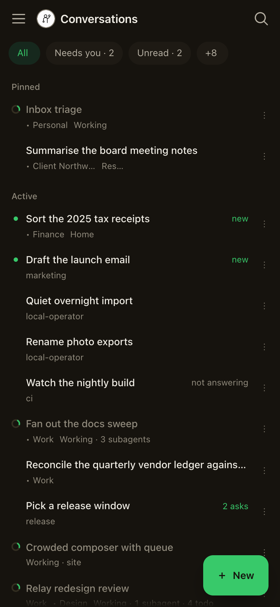</td>
    <td align="center" valign="top">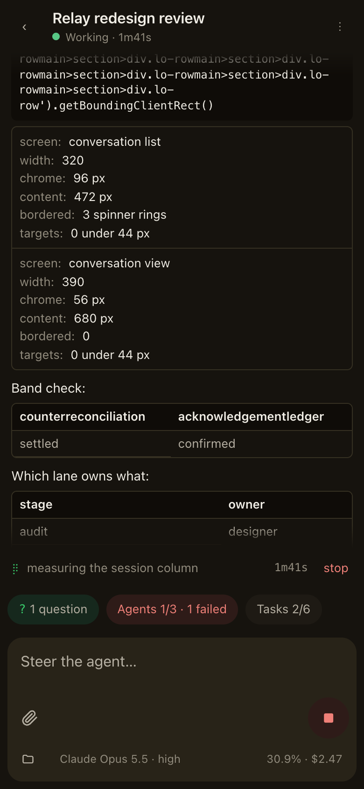</td>
  </tr>
  <tr>
    <td align="center" colspan="2"><i>Web relay (<code>lop mobile</code>), available now</i></td>
  </tr>
</table>

<table width="100%">
  <tr>
    <td align="center" valign="top">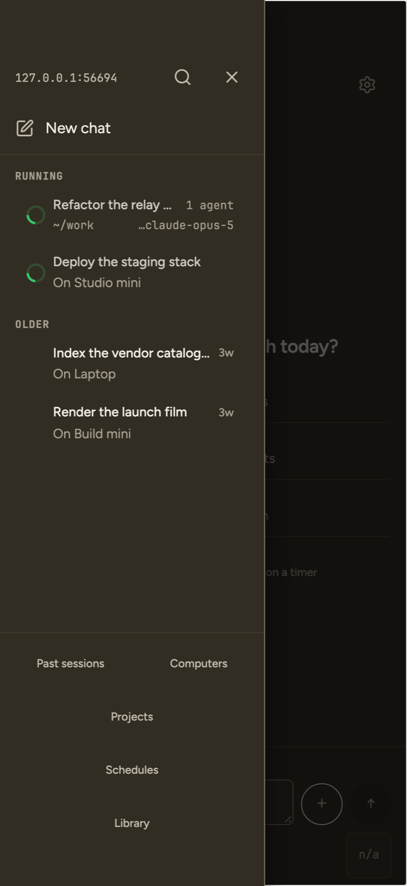</td>
    <td align="center" valign="top">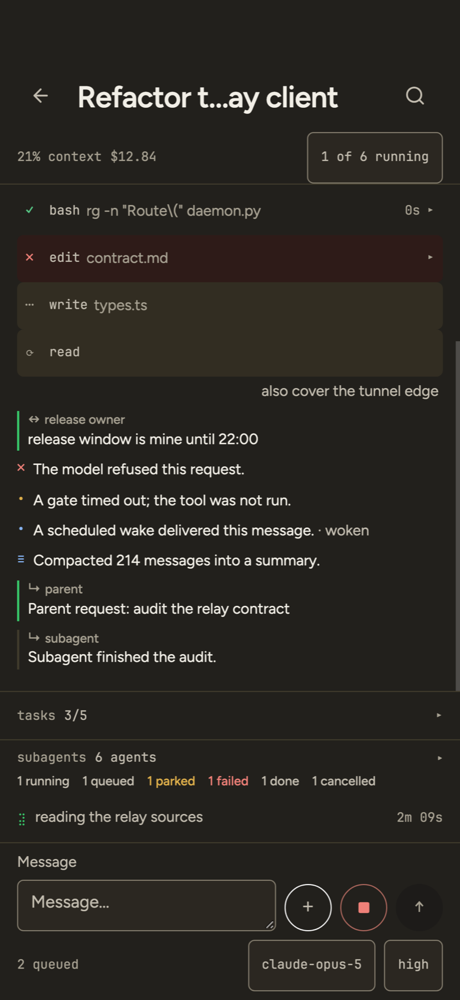</td>
  </tr>
  <tr>
    <td align="center" colspan="2"><i>Native app, in development (not yet in any store)</i></td>
  </tr>
</table>

More → [phone access](docs/guide/phone-access.md) · [mobile reference](docs/mobile.md)

## Browser extension

The free [Local Operator extension](https://chromewebstore.google.com/detail/local-operator/omibaecbjdhgbbcedbnnnmjpmopfheof)
lets the `browser` tool drive Chrome, Edge, Arc or Brave with your real logins,
through a loopback bridge pinned to your extension by a pairing code. The agent
asks before reaching a new site.

```bash
lop browser install && lop browser pair   # then enter the code in the extension popup
```

More → [browser extension](docs/guide/browser-extension.md) · [browser tool reference](docs/BROWSER.md)

## Subscriptions and providers

Sign in with accounts you already have. Two accounts on one provider form a
rotation pool; when a pool is spent, the request walks your model fallback
chain. `/usage` shows quota windows and spend, `/failovers` the cascade.

| Provider | Sign in / key |
| --- | --- |
| ChatGPT / OpenAI | `lop login openai` (Plus/Pro; `openai-device` headless), or `OPENAI_API_KEY` |
| Claude / Anthropic | `lop login anthropic` (Pro/Max), or `ANTHROPIC_API_KEY` |
| Kimi (Moonshot) | `lop login kimi` / `kimi-wechat`, or `KIMI_API_KEY` |
| Grok / xAI | `lop login xai-oauth`, or `XAI_API_KEY` |
| Z.AI (GLM) | `lop login zai-oauth` (GLM Coding Plan), or `ZAI_API_KEY` |
| Qwen (Alibaba) | `lop login alibaba-token-plan-oauth`, or API key |
| Meta Muse Code (unofficial) | `lop login meta-muse` ([limitations](docs/META_MUSE.md)) |
| Google Gemini · DeepSeek · Mistral | `GOOGLE_AI_STUDIO_API_KEY` · `DEEPSEEK_API_KEY` · `MISTRAL_API_KEY` |
| OpenRouter · Radient | `OPENROUTER_API_KEY` · `lop login radient` (automatic per-step model selection) |
| LM Studio, Ollama, vLLM, llama.cpp, OpenAI-compatible | `/login`, your own server, optional token ([guide](docs/LOCAL_PROVIDERS.md)) |

The prompt is laid out for provider prompt caches: a stable prefix,
cache-aware pruning of stale tool output, a longer Anthropic cache window for
large contexts, and lazily loaded skills and MCP tools.

More → [subscriptions and failover](docs/guide/subscriptions.md) ·
[providers](docs/guide/providers.md) · [cache efficiency](docs/guide/cache-efficiency.md) ·
[Radient](docs/guide/radient.md)

## Terminal UI

A full-screen [Textual](https://textual.textualize.io/) app: every tool call is
an expandable card or a one-line receipt, approvals show the exact command, and
the status line tracks step, tokens and cost.

<p align="center">
  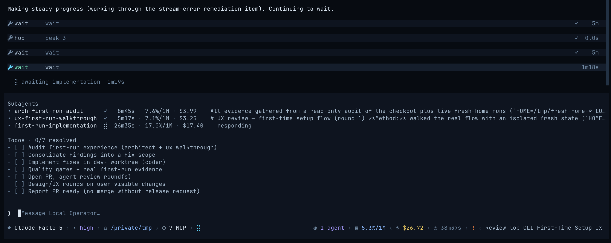
</p>

| Command / key | What it does |
| --- | --- |
| `/model`, `/effort`, `/fast` | Switch model · reasoning effort (`shift+tab` cycles) · fast mode |
| `/approvals` | Whether tools ask first (`ask` / `auto`) |
| `/resume`, `/new`, `/reload`, `/update` | Past sessions · fresh conversation · relaunch · upgrade |
| `/goal`, `/loop` | Set an objective a judge checks each turn · iterate toward it |
| `/team`, `/skills`, `/mcp`, `/search` | Teams · loaded skills · MCP servers · web-search providers |
| `/usage`, `/context`, `/session`, `/failovers` | Quota and spend · context contents · session cost · model cascade |
| `/credential` | Hand over a secret as a masked chip the model never reads |
| `/network`, `/move` | Mesh peers and sessions · move a session between devices |
| `/btw`, `f8` | Side question off the record · aside without losing your draft |
| `$<skill>` | Run a named skill on the rest of the line |
| `esc` · `ctrl+b` · `ctrl+t` / `ctrl+g` | Stop the agent · sidebar · to-do list / subagent panel |

Type while the agent works and your message lands as steering at its next step.

More → [TUI tour, full command and key tables](docs/guide/tui.md)

## What the agent can do

`bash`, a persistent Python `eval`, `read`/`write`/`edit`/`glob`/`grep`/`lsp`,
load-balanced `web_search` (free providers first), `web_fetch`, `browser`,
`todo`, `ask`, `secret`, and the organization tools (`task`, `hub`, `jobs`,
`wait`, `send`, `agent`, `team`, `wake`). Skills (`SKILL.md` folders) are
indexed semantically and load on demand; MCP servers load tool schemas only
when enabled.

More → [tools, web search, skills and MCP](docs/guide/tools.md) · [MCP reference](docs/mcp.md)

## Headless and server

```bash
lop exec "summarize the failures in ./test.log"          # exit code 0 = success
lop exec "review the change" --team release --background
lop serve                                                # FastAPI on 127.0.0.1:1111
```

More → [headless and server modes](docs/guide/headless-and-server.md) ·
[exec reference](docs/EXEC.md) · [SDK](docs/SDK.md)

## Configuration and credentials

Configuration lives in `~/.local-operator/config.yml` (`lop config list`, or
`/settings` in the TUI); machine-wide instructions in
`~/.local-operator/system_prompt.md`, plus `~/.agents/AGENTS.md` if present.
Provider keys (`lop credential`), OAuth logins (`lop login`), session
credentials (`/credential`) and the AES-256-GCM encrypted long-term store
(`lop secret`) are separate, each with its own guarantees and limits.
Optional extras (`server`, `mcp`, `images`, `tokenizer`, `fetch`, `lsp`, `all`),
Nix and Docker are covered too.

More → [installation options, configuration, credentials and shell environment](docs/guide/configuration.md)

## Safety model

- **Approval-gated by default**: reads run; writes, commands and scheduled
  wakes ask first, showing the exact command. `/approvals auto` or `--yolo`
  opt out explicitly.
- **Visible receipts** for every tool call; peer messages arrive as distinct cards.
- **Roles cannot escalate**, and neither can anything they delegate to.
- **Loopback only**: peer messaging, the mobile daemon and the browser bridge
  bind to loopback and authenticate.
- **Local-first option**: a local model with `lop search off` and
  `lop fetch set enabled off` keeps every prompt on the machine.

More → [safety model](docs/guide/safety.md) · [endpoint protection](docs/ENDPOINT_PROTECTION.md)

## Contributing

See [CONTRIBUTING.md](CONTRIBUTING.md) for bug reports, development setup and
pull requests; [AGENTS.md](./AGENTS.md) is the working guide for agents
changing this codebase, and [docs/REWRITE.md](./docs/REWRITE.md) covers the
architecture. The [documentation map](docs/README.md),
[evaluation catalog](evals/README.md) and [benchmark catalog](benchmarks/README.md)
index current guidance, reusable tooling and historical records.

## Credits

Local Operator's implementation was shaped by studying these open-source
projects; thank you to their authors and contributors:
[opencode](https://github.com/anomalyco/opencode) (Dax Raad and the Anomaly team) ·
[oh-my-pi](https://github.com/can1357/oh-my-pi) (Can Bölük), building on
[Pi](https://github.com/earendil-works/pi) (Mario Zechner) ·
[DeepSeek Harness](https://github.com/deepseek-ai/deepseek-harness) (DeepSeek AI; not reviewed or endorsed by them) ·
[pstack](https://github.com/cursor/plugins/tree/main/pstack) (Lauren Tan) ·
[superpowers](https://github.com/obra/superpowers) (Jesse Vincent) ·
[anthropics/skills](https://github.com/anthropics/skills) (Anthropic) ·
[ux-ui-agent-skills](https://github.com/plugin87/ux-ui-agent-skills) (plugin87) ·
[claude-skills](https://github.com/jezweb/claude-skills) (Jeremy Dawes) ·
[agent-config](https://github.com/event4u-app/agent-config) (event4u-app) ·
[platform-design-skills](https://github.com/ehmo/platform-design-skills) (ehmo) ·
[microsoft/skills](https://github.com/microsoft/skills) (Microsoft) ·
[mattpocock/skills](https://github.com/mattpocock/skills) (Matt Pocock) ·
[awesome-agent-skills](https://github.com/VoltAgent/awesome-agent-skills) (VoltAgent).
What each one informed, and a note on reuse and credit:
[credits in full](docs/guide/credits.md).

Core contributor: Damian Tran &lt;[damian@gominerva.com](mailto:damian@gominerva.com)&gt;.

## License

MIT. See [LICENSE](LICENSE).
