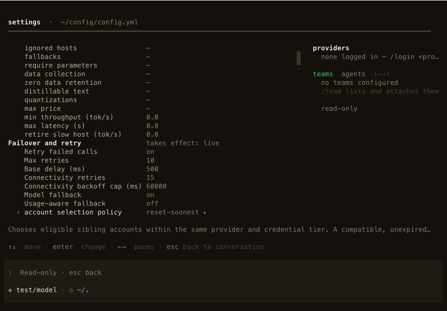
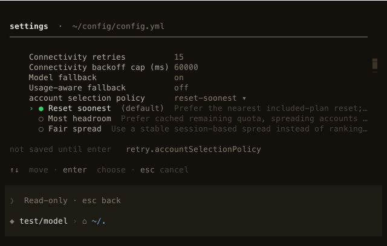
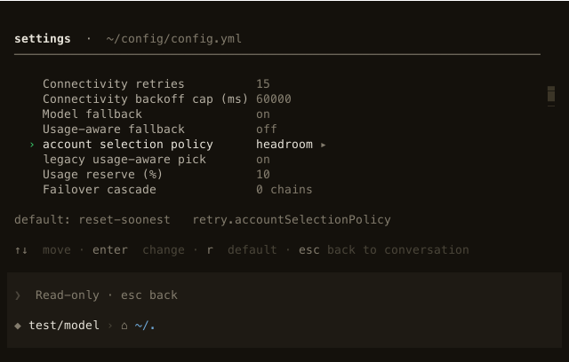
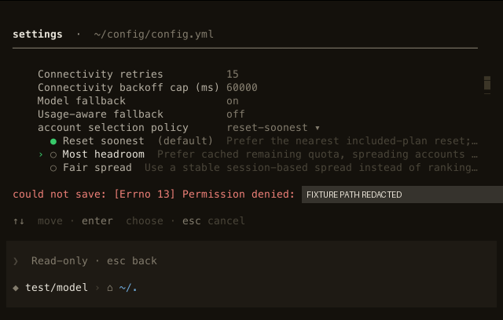
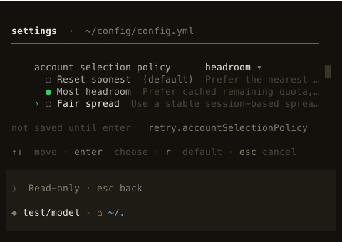
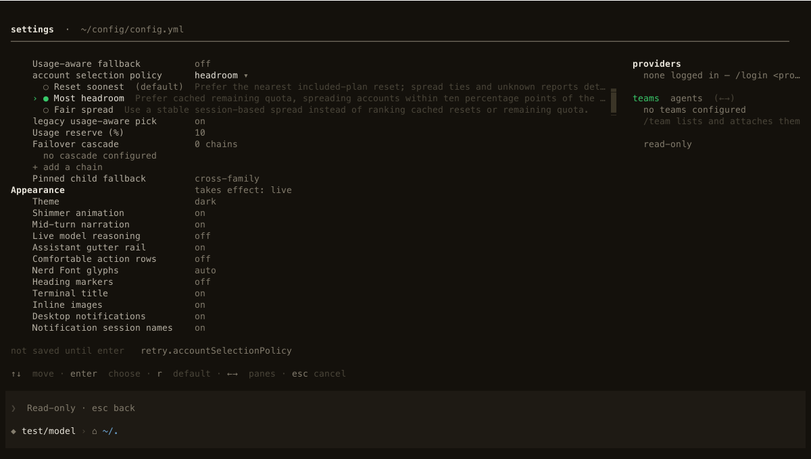

# LOH-12 / PR #2453 — retained TUI evidence

Data-only evidence branch for [local-operator PR #2453](https://github.com/damianvtran/local-operator/pull/2453). **Retain this branch after the feature PR merges. Never merge this branch or its binary files to `main`.** This follows the operator-authorized hackathon evidence-branch publication pattern.

## Provenance and limits

- Baseline TUI source: `d825a26343bcac566a6ded451eb7b251bfe049b5`.
- Changed TUI source: `8ca468c3346409989632f3fe72b246c48861b7ee`. TUI, settings metadata, catalogue and renderer bytes are unchanged through reviewed remediation `a6e7a5997d0b99b4945d17534282c846e029a349`; these images are retained on that precise compatibility basis, not re-labelled as a new capture.
- Frames come from the real stylesheet-loading `OperatorApp` under its `run_test` driver, not a bare widget host. The baseline/current 110x36 frames were captured by the implementer. The 80x24, 60x20 and 150x40 frames were independently captured by the UX reviewer using keyboard selection/cancel/save/reset/rejected-write/retry flows.
- Every session, account, path and response represented is synthetic. No provider inference, quota endpoint, real customer data, live credential store, or live conversation was used to capture these frames.
- PNG ancillary metadata is removed. For unredacted images, decoded RGBA pixels were verified byte-identical to the reviewed originals. `SHA256SUMS` binds the published files.
- `tui-rejected-80x24-redacted.png` changes ONLY the explicitly labelled rectangle x384..639/y237..258 to conceal a private synthetic fixture path. The permission-denied text, stored-policy marker, attempted cursor and all pixels outside that rectangle are unchanged. This is a disclosed privacy redaction, not an application UI element or altered test outcome.
- The inherited low-contrast explanatory text remains a recorded MINOR design finding (D1); these images do not conceal it or claim it was fixed.
- This gallery is TUI evidence only. It does not establish desktop, relay-web, native-mobile or public-docs rendered acceptance, CI success, or overall LOH-12 release readiness. Fresh relay evidence remains separately gated on approval for the uniquely isolated fixture origin. No original shared-localhost browser capture is published here.

## Reviewed frames

### Before — 110x36

### After — 110x36

### Options — independent 80x24

### Persisted selection — independent 80x24

### Rejected write — independent 80x24, path redacted

### Narrow keyboard access — independent 60x20

### Wide layout — independent 150x40

