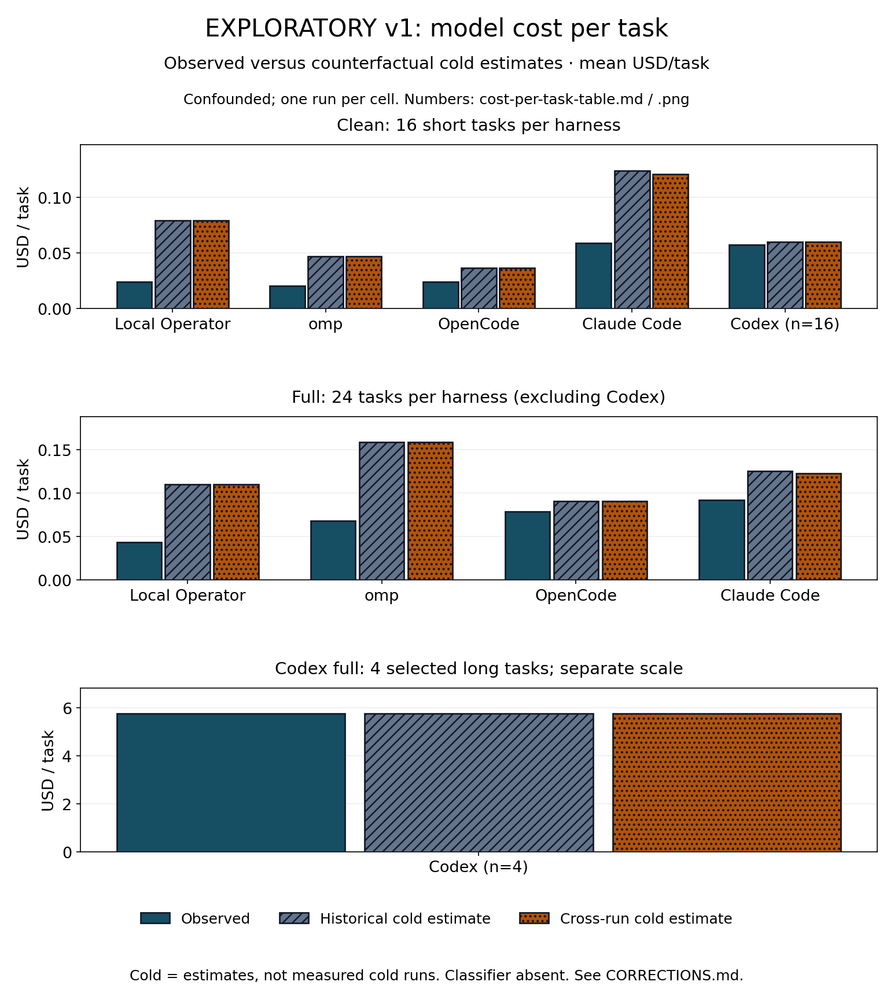
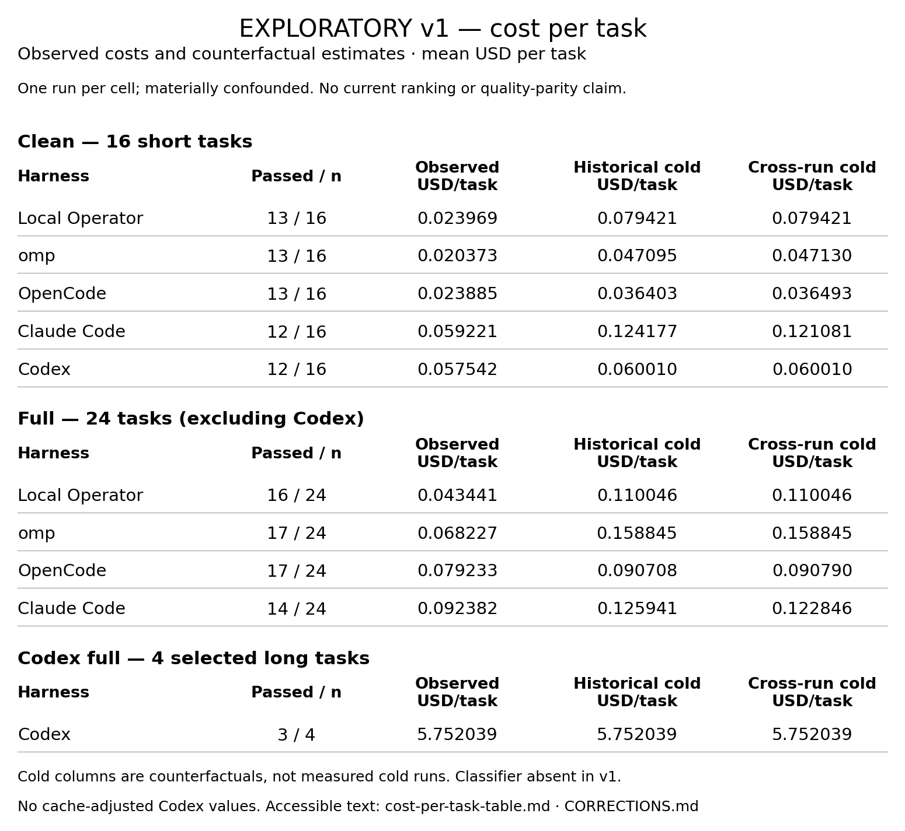

# Harness-cost analysis kit — EXPLORATORY v1

**This is a reproducibility and methods artifact, not a promotional benchmark or
an estimate of current harness performance.** The historical v1 study is
materially confounded. The author develops Local Operator (conflict of interest).
Read [CORRECTIONS.md](CORRECTIONS.md) and the
[independent rigor review](reviews/REVIEW-RIGOR-R1.md) before using any number.

## Zero-spend regeneration

Requires Python **3.12–3.14**, [uv](https://docs.astral.sh/uv/), and about 250 MB
for a small environment (shared cache reduces additional physical disk use).
No harness, API key, authenticated service, office suite, model call, or private
workspace is required. Dependency download is the only necessary network access;
with wheels cached, installation can use `uv pip install --offline`.

From this directory, whether in a public checkout or an extracted ZIP:

```sh
uv venv --python python3 .venv
uv pip install --python .venv/bin/python -r requirements.txt
.venv/bin/python publication.py verify
.venv/bin/python regenerate.py
```

**The last line is the ONE analysis command.** It reads only
`v1-snapshot/requests.jsonl`, `runs.jsonl` and the task identity/tier manifest to
compute results. The four historical JSON outputs are subsequently read **only
as validation references**, never as the producing algorithm's inputs.
It fails on population, duplicate, missing-value, per-call/per-run reconciliation,
or numerical-parity discrepancies; checks are active under `python -O` too.
Use `--out /chosen/output` or `--snapshot /chosen/snapshot` if needed.

## Readable cost graph and companion table — exploratory v1



**[Accessible, selectable cost-per-task table (Markdown)](generated/cost-per-task-table.md)**
— the same derived values and pass/sample counts as the graph, with observed
USD/task separated from both counterfactual cold estimates. No current ranking
or quality-parity claim is supported. No historical adjusted Codex cost is shown.



The graphs and table use text of at least 12 CSS pixels when embedded at 861 CSS
pixels wide, with source geometry checks (current minimum exceeds 13.8 px).
Hatching and dark boundaries distinguish estimates/components without color
alone. Smaller widths should use the accessible Markdown table rather than
shrinking the numeric graphic.

`generated/` contains:

- `results.json` / `.csv`: 180 rep-0 rows, raw model costs, scores, cold estimates,
  classifier status, and separately labelled Codex historical sensitivity;
- `summary_tables.json` / `.csv`: clean/full, short/long/all, and matched-four
  slices (no unmatched Codex all-task population);
- `figure_data.json` / `.csv`: historical figure values retained for parity;
- `cost_components_long.json` / `.csv`: all cost components, including uncached
  input and side calls, on 8 long tasks (Codex: 4);
- `call_sequences.json` / `.csv`: per-main-call context and all-call cost series;
- `reconciliation.json` / `.csv`: checks for all 186 runs, including 6 smoke runs;
- `fig1-cost-per-task.png`: observed and both counterfactual cold estimates,
  clean and full arms, separate Codex panel;
- `fig2-why-costs-differ.png`: complete observed cost-component stacks;
- `cost-per-task-table.png` / `.md`: readable graphic and accessible numeric
  table, separating clean-16/full-24/Codex-full-4; observed costs, counterfactuals
  and pass/sample counts from the same derived rows;
- `cost-per-task-table.json` / `.csv`: full-precision source rows for that table;
  Markdown numeric cells are checked against this JSON during regeneration;
- `figure_geometry.json`: text-versus-canvas bounds, table overlap gate,
  861-CSS-pixel font measurements, and pattern/boundary-contrast evidence.

All machine-readable money is **USD**, not cents. All token counts are tokens,
not bytes. Float comparisons use absolute tolerance $1e-10 / relative 1e-11;
no intermediate monetary rounding. CSV nested fields are JSON-encoded cells.
The historical compatibility fields `figure_data.codex.long4`, `.cpp` and
`.ratio4` are **sensitivity estimates**, not observations. The explicit
`long4_measured` field is the observed cost. Neither the old ratio nor the
adjusted cost is used in the new figures.

## Frozen population and caveats

There are 24 selected OSWorld tasks (16 short, 8 long), 180 rep-0 run records,
6 smoke run records, 1,575 metering records, and 1,533 priced responses. Clean
has 16 short tasks × 5 harnesses; full has 24 × 4 plus Codex's first 4 long
tasks. No run is silently dropped. Score ≥ 1 counts as a pass. Infrastructure
failures are flagged, not retroactively reclassified or rerun. The upstream
selection universe has **368** tasks (multi_apps: **101**), correcting the
historical review's 369/102 count; this kit does not establish an eligible v2
sample or promise 60 feasible tasks.

- One repeat per cell: no run-to-run uncertainty estimate, no pass-rate ranking.
- Cache warmth depends on order/timing and a disk pause; observed is not a
  controlled steady-state treatment. Counterfactual cold is not measured cold.
  The full-arm arithmetic ordering reverses versus OpenCode under cold pricing.
- Codex's fallback model metadata triggered repeated compaction, with different
  thinking behavior and proxy cache injection; n=4 and a post-hoc sensitivity
  cannot support a current-performance ratio or schema-only causal explanation.
- Unequal private instructions/skills/plugins, effort, output budget and side
  calls; task selection, checker feasibility, instruction ambiguity and crashes
  confound both quality and cost. Historical pass counts are not quality parity.
- OpenRouter `usage.cost` confirms a rate-card calculation from the **same usage
  block**, not an independent invoice or independent token measurement.
- v1 did **not** enable the Radient classifier. Its explicitly absent component
  is recorded separately as zero marginal cost by configuration, not falsely
  described as metered. Total equals model cost for v1. No unobserved v2
  classifier cost is inferred, and v1/v2 observations are not pooled.
- Logged scores are reproducible as data; full checker/artifact re-execution is
  **not** possible from this public kit. Private result artifacts and office
  fixtures are intentionally excluded. See `reviews/README.md`.

Any future v2 preregistration/selection is a **draft/pending evidence** process,
not validated by reproducing these v1 numbers. A new public loadout is included
for transparent methods, not as a byte-matched v1 replacement or a measured v2
result. No v2 harness runs are performed by this kit.

## Experimental live-rerun methods — not yet qualified

The separate [experimental methods directory](experimental/README.md) contains
seven-harness configuration tooling, Codex's model catalog/tool-search bridge,
a guarded metering proxy, a candidate cache-isolation adapter, opt-in pinned
OSWorld fixture fetching/evaluation, and Terminal-Bench/Harbor drivers. Its
[verification record](experimental/VERIFICATION.md) distinguishes offline tests
from native/live runs that remain unverified.

**This is not a completed expanded benchmark.** The preregistration is a draft;
task eligibility, full runtime/tool exposure, conservative hosted-classifier
billing reservations, and coding pilots remain gates. In particular, the public
runner refuses paid Local Operator execution until its Radient classifier
reservation is qualified; it does not silently disable recommendations. A
reproducer supplies their own `lop login radient` session—no token is included.
These scripts neither run during zero-spend analysis nor establish quality parity.

## Public loadout (optional; not used for analysis)

`public_loadout/` carries 493 OSS MCP tool schemas, neutral instructions, pinned
skill hashes, fetch/capture/replay scripts and a portable base-home builder.
See [its README](public_loadout/README.md) and
[THIRD_PARTY_NOTICES.md](THIRD_PARTY_NOTICES.md). The default regeneration
command does not fetch skills, launch a schema server, run capture, or make any
requests to a model. Package capture and skill fetch require network access but
no paid model calls. No skill sources or proprietary document skills are
redistributed. Their licenses apply when fetched.

## Privacy, provenance and packaging

`PROVENANCE.json` records original frozen file hashes and exact minimization
rules. Metering has usage and size metadata only; no raw request bodies,
internal MCP schemas, personal instructions, auth databases, tokens, or home
paths. Task specs are projected to ID/domain/tier. Original promotional figures
and REPORT.md are deliberately **not** shipped. Historical output JSON remains
under `v1-snapshot/` solely for numerical parity; it is not an endorsed report.

```sh
python3 publication.py scan       # verify checksums + bounded secret/PII scan
python3 publication.py zip --output /chosen/path/harness-cost-kit-review-r1-remediation.zip
```

In Git, the ZIP builder refuses inventory members not yet tracked. The
coordinator must stage/review this new folder first; it never stages files,
commits, or opens PRs. Outside Git, the verified manifest is the package
allowlist. ZIP members have normalized timestamps, contain only this kit,
and never include `.git`, environments, caches, fetched skills or extra files.
An existing ZIP is not overwritten. While the parallel experimental port is
active, global manifests/ZIPs remain provisional; the coordinator must refresh
them once all files are frozen. The core-remediation snapshot archive is
`harness-cost-kit-review-r1-remediation.zip`; any older `harness-cost-kit.zip` is
obsolete and must not be distributed (it predates the invocation-metadata
privacy and CSV-LF fixes). The intermediate publication-r2 archive is also
superseded by the review-r1-remediation archive, which adds accessible tables,
readable patterned figures and recursive metering metadata validation. Maintainers who intentionally change files
run `python3 publication.py manifest` after scanning/review and regenerate it
again after updating evidence. The manifest excludes its own two control files
to avoid circular hashes; SHA256SUMS includes MANIFEST.json. Regeneration on a
different platform/font stack may change rendered PNGs and their geometry
metadata without changing numerical results. Verify the distributed manifest
**before** regeneration; to publish your newly rendered kit, review it and run
`python3 publication.py manifest` again before `zip`.

Run `TMPDIR=/chosen/scratch .venv/bin/python test_kit.py` for the bounded
regression/negative controls (16 tests, no additional dependencies).

See [REPRODUCTION.md](REPRODUCTION.md) for the kit-only extraction test,
negative controls, actual reconciliations and rendered-frame checks. Numerical
parity is the acceptance criterion; **pixel-identical plots across platforms or
fonts are not promised**. This folder inherits the repository MIT license;
third-party schema notices and full upstream license texts are included.
