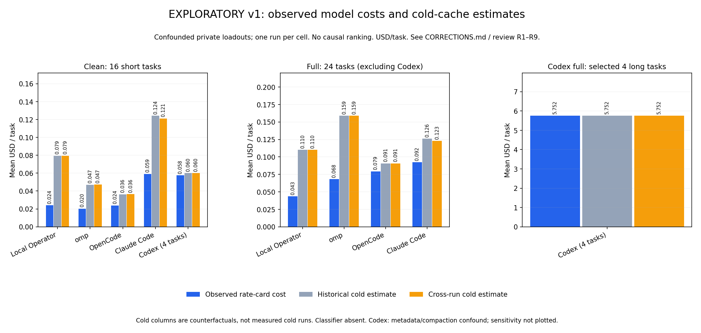
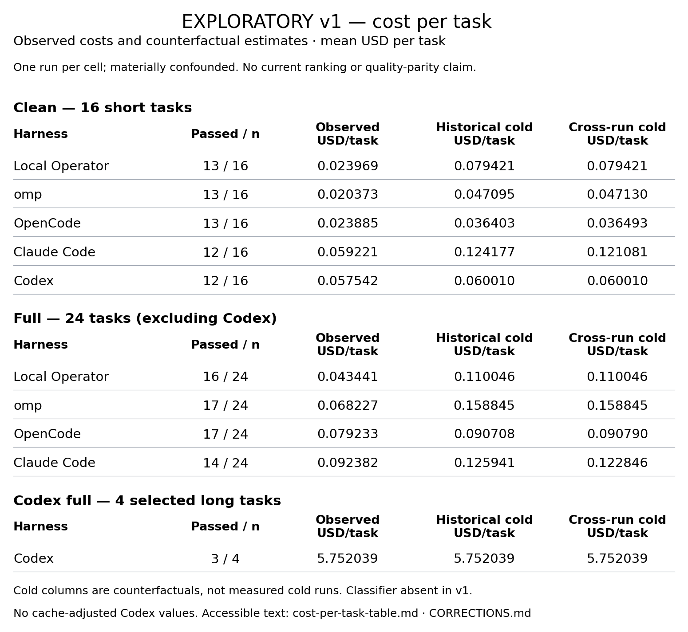

# Harness-cost analysis kit — exploratory v1

This kit reproduces, at zero model spend, a historical comparison of what agent
harnesses cost on the same OSWorld desktop tasks. It ships the frozen metering
data, the one analysis command, [CORRECTIONS.md](CORRECTIONS.md) and an
[independent rigor review](reviews/REVIEW-RIGOR-R1.md). It is a single-run,
exploratory study: one run per task and harness, no repeats. It is not an
estimate of current harness performance.

## Results under full configuration

The headline ("full") arm ran each harness in a production-scale configuration
rather than a bare one: the same 24 OSWorld tasks (Codex: only its first 4 long
tasks), the same main model (Claude Sonnet 5.5) through the same metering
proxy, priced on the same frozen rate card. Each harness was configured with an
MCP tool catalog of roughly 480 tools and with skills, and every harness except
OpenCode with instruction files. How much of that catalog reached the model
depended on how each harness exposes tools: eagerly in its tool list, through
tool search, or not in its tool list at all (see the Tools item under
[Configuration differences](#configuration-differences)).
This is a deliberate method choice: it approximates cost as a harness is used
with a real setup. A bare configuration, with no skills, MCP servers or real
system prompt, is easier to match but less representative of real use. A full
configuration is not a byte-identical one, though: each harness loads
instructions, skills and tools in its own way, and the specific differences are
listed under [Configuration differences](#configuration-differences).

The generated table, figures and `PROVENANCE.json` keep their frozen v1 label,
"materially confounded"; the configuration differences and caveats below are
the specific statement of what that label refers to.

Observed cost per task, full arm, from
[the generated table](generated/cost-per-task-table.md):

| Harness | Passed / n | Observed USD/task |
|---|---:|---:|
| Local Operator | 16 / 24 | 0.043 |
| omp | 17 / 24 | 0.068 |
| OpenCode | 17 / 24 | 0.079 |
| Claude Code | 14 / 24 | 0.092 |

Local Operator had the lowest observed cost per task on the full 24-task set
($0.043 against $0.068–$0.092). Pass counts were close (14–17 of 24) and, with
one run per cell, do not rank quality. Codex ran only 4 long tasks in this arm,
at $5.75 per task, inflated by a repeated-compaction problem; it is reported as
a separate population (see caveats).

**Why observed cost leads.** Observed cost includes the prompt-cache reads the
harnesses actually made. Within a task, reuse is measured here: after the first
main call, Local Operator's later main calls read a median 97.6% of their
prompt from cache (omp and Claude Code are similar, so this is not specific to
Local Operator; it is not universal either: Codex's later main calls in this
arm read a median 0%). Reuse across repeated runs holds only while a rerun
lands inside the provider's cache window. In this run Local Operator's first
main call read a median 95% of its prompt from cache because the same harness
had run a task with the same prefix a median 1.1 minutes earlier (review R2).
22 of 24 Local Operator runs started within the 5-minute TTL; the other two,
after gaps of about 9 and 32 minutes, read 0% from cache on their first main
call (recomputed from `v1-snapshot/requests.jsonl`; review R2's "23 of 24" is
the Claude Code figure). A rerun outside that window starts cold, and observed
warmth here depends on run order and timing, as the caveats below note.

As a separate measurement, not a result of this kit,
[docs/BENCHMARKS.md](../../docs/BENCHMARKS.md) measures Local Operator alone:
two task-cost runs on a different model (deepseek-v4-flash) and coding tasks
reached 88.1% and 89.9% warm cache rates (90.6% and 91.3% on the longest
task), and a live 30-turn trajectory reached a 94.2% cache rate that cost
$0.0164 against $0.0517 uncached, a 68% saving.

**Cold columns: a pessimistic sensitivity check.** The two cold estimates
reprice cache reads that a run inherited from earlier runs, approximating a
one-off task on a cold cache ([CORRECTIONS.md](CORRECTIONS.md) defines each).
They are counterfactual estimates, not measured cold runs, and not an upper
bound on what a cold run could cost. Under that pricing the full-arm order
changes: OpenCode ($0.091) comes in below Local Operator ($0.110). Local
Operator's mean stays below Claude Code's ($0.123–$0.126), but per task the
two are about even (paired cold ratio, Claude Code / Local Operator, 1.03,
95% CI 0.76–1.21; review R2); omp is highest ($0.159).

**The clean arm.** A second arm ran 16 short tasks with five harnesses without
the loadout (the preregistration's "clean/no-loadout arm"), concurrently. There
Local Operator was not the cheapest observed: omp $0.020, OpenCode $0.024,
Local Operator $0.024, Codex $0.058, Claude Code $0.059. Its cold estimate
($0.079) was the second highest.

## Zero-spend regeneration

Requires Python **3.12–3.14**, [uv](https://docs.astral.sh/uv/), and about 250 MB
for a small environment (shared cache reduces additional physical disk use).
No harness, API key, authenticated service, office suite, model call, or private
workspace is required. Dependency download is the only necessary network access;
with wheels cached, installation can use `uv pip install --offline`.

From this directory, whether in a public checkout or an extracted ZIP:

```sh
uv venv --python python3 .venv
uv pip install --python .venv/bin/python -r requirements.txt
.venv/bin/python publication.py verify
.venv/bin/python regenerate.py
```

**The last line is the ONE analysis command.** It reads only
`v1-snapshot/requests.jsonl`, `runs.jsonl` and the task identity/tier manifest to
compute results. The four historical JSON outputs are subsequently read **only
as validation references**, never as the producing algorithm's inputs.
It fails on population, duplicate, missing-value, per-call/per-run reconciliation,
or numerical-parity discrepancies; checks are active under `python -O` too.
Use `--out /chosen/output` or `--snapshot /chosen/snapshot` if needed.

## Readable cost graph and companion table — exploratory v1



**[Accessible, selectable cost-per-task table (Markdown)](generated/cost-per-task-table.md)**
— the same derived values and pass/sample counts as the graph, with observed
USD/task separated from both counterfactual cold estimates. No current ranking
or quality-parity claim is supported. No historical adjusted Codex cost is shown.



The graphs and table use text of at least 12 CSS pixels when embedded at 861 CSS
pixels wide, with source geometry checks (current minimum exceeds 13.8 px).
Hatching and dark boundaries distinguish estimates/components without color
alone. Smaller widths should use the accessible Markdown table rather than
shrinking the numeric graphic.

`generated/` contains:

- `results.json` / `.csv`: 180 rep-0 rows, raw model costs, scores, cold estimates,
  classifier status, and separately labelled Codex historical sensitivity;
- `summary_tables.json` / `.csv`: clean/full, short/long/all, and matched-four
  slices (no unmatched Codex all-task population);
- `figure_data.json` / `.csv`: historical figure values retained for parity;
- `cost_components_long.json` / `.csv`: all cost components, including uncached
  input and side calls, on 8 long tasks (Codex: 4);
- `call_sequences.json` / `.csv`: per-main-call context and all-call cost series;
- `reconciliation.json` / `.csv`: checks for all 186 runs, including 6 smoke runs;
- `fig1-cost-per-task.png`: observed and both counterfactual cold estimates,
  clean and full arms, separate Codex panel;
- `fig2-why-costs-differ.png`: complete observed cost-component stacks;
- `cost-per-task-table.png` / `.md`: readable graphic and accessible numeric
  table, separating clean-16/full-24/Codex-full-4; observed costs, counterfactuals
  and pass/sample counts from the same derived rows;
- `cost-per-task-table.json` / `.csv`: full-precision source rows for that table;
  Markdown numeric cells are checked against this JSON during regeneration;
- `figure_geometry.json`: text-versus-canvas bounds, table overlap gate,
  861-CSS-pixel font measurements, and pattern/boundary-contrast evidence.

All machine-readable money is **USD**, not cents. All token counts are tokens,
not bytes. Float comparisons use absolute tolerance $1e-10 / relative 1e-11;
no intermediate monetary rounding. CSV nested fields are JSON-encoded cells.
The historical compatibility fields `figure_data.codex.long4`, `.cpp` and
`.ratio4` are **sensitivity estimates**, not observations. The explicit
`long4_measured` field is the observed cost. Neither the old ratio nor the
adjusted cost is used in the new figures.

## Frozen population, configuration and caveats

There are 24 selected OSWorld tasks (16 short, 8 long), 180 rep-0 run records,
6 smoke run records, 1,575 metering records, and 1,533 priced responses. Clean
has 16 short tasks × 5 harnesses; full has 24 × 4 plus Codex's first 4 long
tasks. No run is silently dropped. Score ≥ 1 counts as a pass. Infrastructure
failures are flagged, not retroactively reclassified or rerun. The upstream
selection universe has **368** tasks (multi_apps: **101**), correcting the
historical review's 369/102 count; this kit does not establish an eligible v2
sample or promise 60 feasible tasks.

Each cell has one run, so there is no run-to-run uncertainty estimate and no
pass-rate ranking. The remaining caveats:

- Cache warmth depends on order/timing and a disk pause; observed is not a
  controlled steady-state treatment. Counterfactual cold is not measured cold.
  The full-arm arithmetic ordering reverses versus OpenCode under cold pricing.
- Codex's fallback model metadata triggered repeated compaction, with different
  thinking behavior and proxy cache injection; n=4 and a post-hoc sensitivity
  cannot support a current-performance ratio or schema-only causal explanation.
- Task selection, checker feasibility, instruction ambiguity and one
  terminated run (Claude Code, exit 143, cause not established; review R4)
  affect both quality and cost. Historical pass counts are not quality parity.
- OpenRouter `usage.cost` confirms a rate-card calculation from the **same usage
  block**, not an independent invoice or independent token measurement.
- v1 did **not** enable the Radient classifier. Its explicitly absent component
  is recorded separately as zero marginal cost by configuration, not falsely
  described as metered. Total equals model cost for v1. No unobserved v2
  classifier cost is inferred, and v1/v2 observations are not pooled.
- Logged scores are reproducible as data; full checker/artifact re-execution is
  **not** possible from this public kit. Private result artifacts and office
  fixtures are intentionally excluded. See `reviews/README.md`.

### Configuration differences

The full arm shared the task set, main model, metering proxy and rate card, and
configured every harness with a tool catalog of production scale. It did not
give every harness byte-identical instructions, skills, tool exposure or
settings. Each difference below can shift cost between harnesses, so the
observed gap is not attributable to harness design alone. Measured differences
(review R6, from request metadata and bodies; tool payload sizes recomputed
from `v1-snapshot/requests.jsonl`):

- **Instructions.** A shared 3,480-byte instruction file reached Claude Code,
  Codex and omp in full. OpenCode received none. Local Operator received its
  own 19,814-byte system prompt, which carried 4 of the 13 shared lines.
- **Skills.** Skill files per root: Local Operator 30, `.claude` 27, `.codex` 33,
  `.agents` 28, OpenCode 15, omp 15.
- **Tools.** Reported catalog sizes are 480–482 tools; the kit does not show
  that every harness was given the identical set. What reached the model
  differed. Median tool-schema bytes per main call, no-loadout clean arm → full
  arm: Codex 15,442 → 942,651 (494–496 tools on the wire, including plugin
  tools, on 119 of its 234 full-arm main calls; the other 115 alternating calls
  carried a single 140-byte tool); Claude Code 76,349 → 43,385 (22 → 12
  tools, with `ENABLE_TOOL_SEARCH=true`); Local Operator 50,763, omp 17,174
  and OpenCode 13,079 unchanged between arms (28, 11 and 12 tools). For those
  three, the catalog did not appear in the tool list on the wire; the shipped
  data cannot show whether it was loaded lazily or not exposed.
- **Thinking and output budget.** Adaptive thinking with high effort for Claude
  Code, Local Operator and omp; adaptive without an effort setting for OpenCode;
  no thinking for Codex. `max_tokens` was 32,000 for Claude Code and 128,000
  for the others.
- **Side calls.** Each harness made its default title/selection calls, which
  differ in model and number (omp 408 Haiku calls, OpenCode 24 Haiku, Claude
  Code 24 Sonnet, Local Operator 48 Sonnet).
- **Proxy cache injection.** The proxy added `cache_control` to Codex's calls
  and to Claude Code's title calls (24 in the full-arm r0 runs and 2 in smoke
  runs; 42 across all runs).
- **Scheduling.** The clean arm ran its five harnesses concurrently; the full
  arm ran them one after another, so wall times are not comparable across arms.

Any future v2 preregistration/selection is a **draft/pending evidence** process,
not validated by reproducing these v1 numbers. A new public loadout is included
for transparent methods, not as a byte-matched v1 replacement or a measured v2
result. No v2 harness runs are performed by this kit.

## Experimental live-rerun methods — not yet qualified

The separate [experimental methods directory](experimental/README.md) contains
seven-harness configuration tooling, Codex's model catalog/tool-search bridge,
a guarded metering proxy, a candidate cache-isolation adapter, opt-in pinned
OSWorld fixture fetching/evaluation, and Terminal-Bench/Harbor drivers. Its
[verification record](experimental/VERIFICATION.md) distinguishes offline tests
from native/live runs that remain unverified.

**This is not a completed expanded benchmark.** The preregistration is a draft;
task eligibility, full runtime/tool exposure, conservative hosted-classifier
billing reservations, and coding pilots remain gates. In particular, the public
runner refuses paid Local Operator execution until its Radient classifier
reservation is qualified; it does not silently disable recommendations. A
reproducer supplies their own `lop login radient` session—no token is included.
These scripts neither run during zero-spend analysis nor establish quality parity.

## Public loadout (optional; not used for analysis)

`public_loadout/` carries 493 OSS MCP tool schemas, neutral instructions, pinned
skill hashes, fetch/capture/replay scripts and a portable base-home builder.
See [its README](public_loadout/README.md) and
[THIRD_PARTY_NOTICES.md](THIRD_PARTY_NOTICES.md). The default regeneration
command does not fetch skills, launch a schema server, run capture, or make any
requests to a model. Package capture and skill fetch require network access but
no paid model calls. No skill sources or proprietary document skills are
redistributed. Their licenses apply when fetched.

## Privacy, provenance and packaging

`PROVENANCE.json` records original frozen file hashes and exact minimization
rules. Metering has usage and size metadata only; no raw request bodies,
internal MCP schemas, personal instructions, auth databases, tokens, or home
paths. Task specs are projected to ID/domain/tier. Original promotional figures
and REPORT.md are deliberately **not** shipped. Historical output JSON remains
under `v1-snapshot/` solely for numerical parity; it is not an endorsed report.

```sh
python3 publication.py scan       # verify checksums + bounded secret/PII scan
python3 publication.py zip --output /chosen/path/harness-cost-kit-review-r1-remediation.zip
```

In Git, the ZIP builder refuses inventory members not yet tracked. The
coordinator must stage/review this new folder first; it never stages files,
commits, or opens PRs. Outside Git, the verified manifest is the package
allowlist. ZIP members have normalized timestamps, contain only this kit,
and never include `.git`, environments, caches, fetched skills or extra files.
An existing ZIP is not overwritten. While the parallel experimental port is
active, global manifests/ZIPs remain provisional; the coordinator must refresh
them once all files are frozen. The core-remediation snapshot archive is
`harness-cost-kit-review-r1-remediation.zip`; any older `harness-cost-kit.zip` is
obsolete and must not be distributed (it predates the invocation-metadata
privacy and CSV-LF fixes). The intermediate publication-r2 archive is also
superseded by the review-r1-remediation archive, which adds accessible tables,
readable patterned figures and recursive metering metadata validation. Maintainers who intentionally change files
run `python3 publication.py manifest` after scanning/review and regenerate it
again after updating evidence. The manifest excludes its own two control files
to avoid circular hashes; SHA256SUMS includes MANIFEST.json. Regeneration on a
different platform/font stack may change rendered PNGs and their geometry
metadata without changing numerical results. Verify the distributed manifest
**before** regeneration; to publish your newly rendered kit, review it and run
`python3 publication.py manifest` again before `zip`.

Run `TMPDIR=/chosen/scratch .venv/bin/python test_kit.py` for the bounded
regression/negative controls (16 tests, no additional dependencies).

See [REPRODUCTION.md](REPRODUCTION.md) for the kit-only extraction test,
negative controls, actual reconciliations and rendered-frame checks. Numerical
parity is the acceptance criterion; **pixel-identical plots across platforms or
fonts are not promised**. This folder inherits the repository MIT license;
third-party schema notices and full upstream license texts are included.

## Disclosure

The author of this study develops Local Operator, one of the harnesses compared.
The frozen data, the analysis command and an independent rigor review are
published here so that every cost figure can be regenerated from the frozen
metering data without trusting the author. Configuration measurements
(instruction and system-prompt bytes, skill counts, thinking and output
settings) and task scores rest on the review's access to request bodies and
result artifacts that this kit does not ship.
