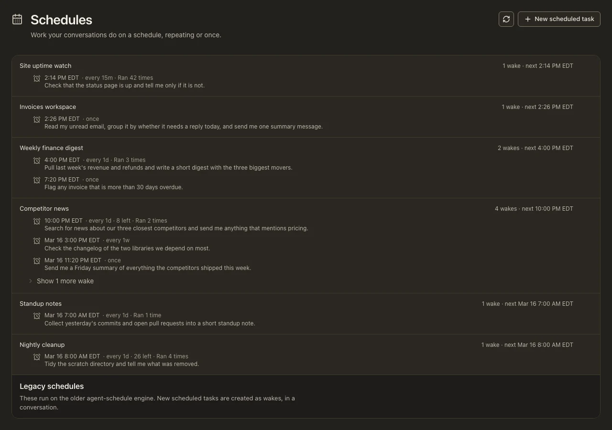

<!-- Moved verbatim from the project README (2026-11-08 README refresh); the README now links here. -->

# Always On

Work keeps moving after you walk away.

- **Scheduled wakes that survive a closed terminal.** The agent's `wake` tool
  schedules a future turn ("check the build again in 30 minutes"). Schedules
  persist with the session. On macOS a small **wake supervisor** (installed
  on demand as a LaunchAgent the first time a wake is scheduled) starts a
  runtime for whichever session's wake is due, so a wake fires even if you
  closed the terminal that scheduled it (a session that is still open fires
  its own). On Linux and Windows there is no supervisor: a wake fires the
  next time that session is running. If a wake fires unattended and a tool
  needs approval, the turn stalls at the prompt until you answer from the
  phone or `/resume`; `/approvals auto` or `--yolo` opts into unattended
  execution. A session that was asleep past a due time fires the wake late
  and reports how many occurrences it skipped, rather than replaying six
  hourly checks at once. `lop wake status` reports whether the supervisor is
  actually *running* (not merely installed), the soonest wake that will fire,
  and how many are overdue, dormant, too stale for the supervisor to keep
  retrying, or blocked by a wedged runtime holding the session lease; `lop
  wake list` shows every schedule with that state per row. When the supervisor
  has stopped or gone missing, `lop wake install` puts it back.
  Human-readable wake times use the machine's
  local timezone, labelled explicitly, with a 12-hour AM/PM clock by default.
  Other dates include the month/day (and year when different). Choose **Wake
  time format** in `/settings` → Appearance, or run
  `lop config edit display.time_format 24h` for a 24-hour clock (`12h` restores
  the default). This changes display only; stored timestamps and JSON output
  remain epoch milliseconds, and existing transcript confirmations are not rewritten.
- **Background jobs that report back on their own.** `task` always runs in
  the background and `bash` can (`background=true`); a long command
  interrupted by a steer detaches instead of dying; and every settled job
  auto-delivers its result when the session is idle. `jobs` peeks at new
  output since your last look.
- **`lop exec --background`** detaches a whole task with a log file and exits
  immediately.
- **Waiting without polling.** `wait` blocks up to 60 minutes and returns the
  moment a job settles, a message arrives (a peer's `send`, a wake, a
  subagent's `hub` note), or you steer. One sized wait replaces a chain of
  short polls that each re-send the whole context.
- **Resume after a restart.** Transcripts persist and `/resume` picks a
  session back up; a paused or settled subagent can be resumed with `hub
  op='resume'` after the parent process has restarted.
- **A daemon that keeps sessions reachable.** `lop mobile install` runs a
  supervised session daemon (LaunchAgent on macOS; on Linux and Windows the
  daemon is portable and foreground-runnable, with no installer yet); every
  interactive session registers with it, and you watch, steer, and start
  sessions from your phone. See [Phone Access](phone-access.md#phone-access-mobile-relay).
  `lop update` restarts the daemon when the LaunchAgent is installed.

  

<i>The Schedules page: every conversation's wakes, repeating or once, with when each fires next and how often it has run.</i>

