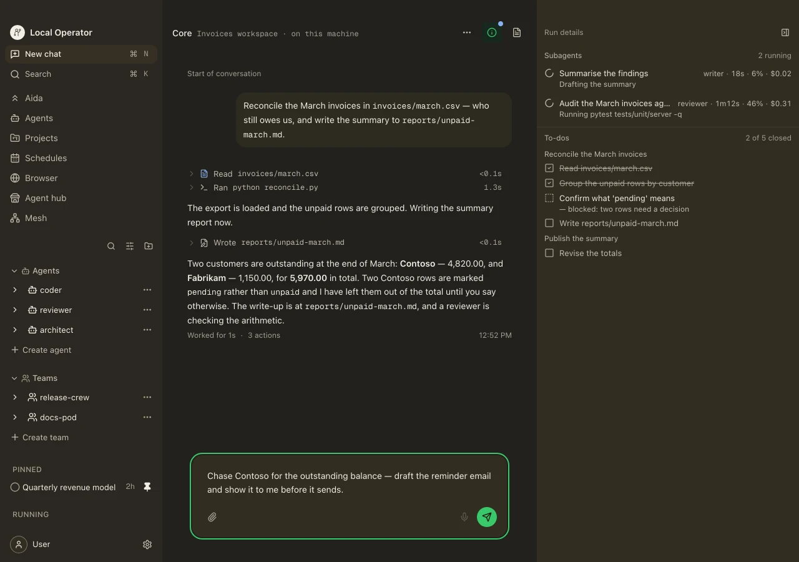
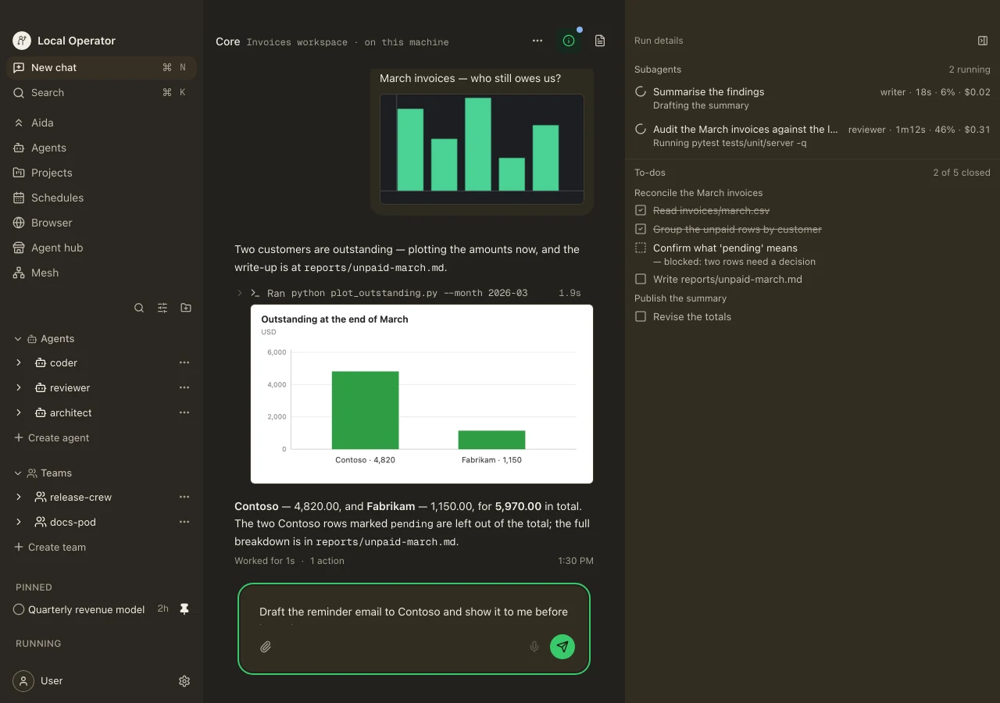

<!-- Moved verbatim from the project README (2026-11-08 README refresh); the README now links here. -->

# Desktop App (local-operator-ui)

The terminal stays the core surface, and the rest of this page describes it.
The desktop app is the second way in: **Local Operator UI** is a desktop
application for macOS, Windows, and Linux that drives the same sessions, teams,
schedules, and configuration, and adds the surfaces a terminal cannot draw.

<p align="center">
  
</p>

<p align="center"><i>The desktop app on the Invoices workspace: the rail with its chats, agents, teams, and mesh; the transcript's tool receipts and streamed write-up; two subagents running above the shared to-do list; and the composer holding a draft. Fixture-driven like the mesh figures below — the real interface over the app's own fixtures, not a live session.</i></p>

What the app adds:

- **A browser the agent can drive.** A Chromium pane with its own tabs and
  address bar lives inside the session window, with an approval prompt before
  the agent acts on a page, so a task can browse where you can watch it.
- **A file canvas and viewer.** Documents a session works on open beside the
  chat — markdown (with a WYSIWYG editor), code, HTML, images, PDFs,
  spreadsheets, audio, and video — instead of being printed into the
  transcript.
- **The same surfaces, as pages.** Agents, schedules, and settings are pages;
  teams are panels on the agents page — all reachable from a command palette,
  over the same configuration the TUI reads, with a built-in theme gallery.
- **A terminal agents can use — coming soon.** A per-session Console tab with
  real terminal emulation, which agents can open, read (stdout and stderr),
  capture visually, and type into. That is what makes end-to-end testing of
  interactive TUIs, and of other commands that need a live terminal, possible
  for an agent where `bash` alone cannot.

<p align="center">
  
</p>

<p align="center"><i>A conversation where images are part of the turn: a chart pasted into the session, and the bar chart the agent plotted and showed inline above its write-up.</i></p>

**Easiest install — the desktop build.** Download the installer for your
platform from the [downloads page](https://local-operator.com/download)
(macOS, Windows, and Linux, with the system requirements listed there). The app
bundles its own backend and installs it on first run, and uses an existing
Local Operator install when it finds one, so a separate `lop` install is
optional.

**Or install from a terminal** (Node.js 22.13.1 or newer):

```bash
npx local-operator-ui              # download and run in one command
npm install -g local-operator-ui   # or install it globally
local-operator-ui                  # ...then start it by name
```

Source, issues, and release notes live at
[damianvtran/local-operator-ui](https://github.com/damianvtran/local-operator-ui).
