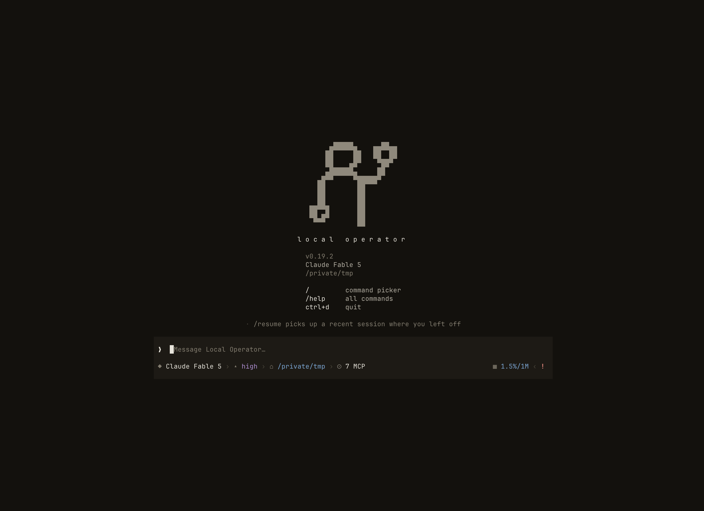

<!-- Moved verbatim from the project README (2026-11-08 README refresh); the README now links here. -->

# Quickstart

One line installs it — no Python needed beforehand (the installer uses
[uv](https://docs.astral.sh/uv/), which brings its own Python 3.12+). It
announces each step with an estimate and finishes in about 20–30 seconds on a
clean machine:

```bash
# macOS / Linux
curl -LsSf https://raw.githubusercontent.com/damianvtran/local-operator/main/scripts/install.sh | sh
```

```powershell
# Windows (PowerShell)
powershell -ExecutionPolicy ByPass -c "irm https://raw.githubusercontent.com/damianvtran/local-operator/main/scripts/install.ps1 | iex"
```

Then start it and sign in:

```bash
lop                  # opens the setup screen
/login radient       # recommended: one browser sign-in, or create an account there
```

**Radient** is the recommended first sign-in: no existing AI subscription or
API key needed, many models behind one account, and it is also what phone
access signs in through. Everything else works too — `/login` lists every
provider, grouped as *Use a subscription* (ChatGPT, Claude, SuperGrok, Kimi,
Z.AI), *Use an API key* (OpenAI, Anthropic, xAI, Google, DeepSeek, OpenRouter,
Mistral, Qwen), and *Run models on this computer* (LM Studio, Ollama, vLLM,
llama.cpp). The same list is `lop login` in a shell.

After you sign in, **Aida** — your chief of staff in Local Operator — opens
and says hello: she asks your name (your Radient account already tells her),
how you want to use AI ("don't know yet" is a fine answer), explains what
Local Operator can do, and helps you set up your first agents and teams.

Prefer a package manager? `uv tool install local-operator` or
`pipx install local-operator` do the same thing. Plain `pip install
local-operator` needs Python 3.12+: on an older Python pip reports *"from
versions: none"*, and on Debian/Ubuntu/Homebrew Pythons it refuses with
*externally-managed-environment* — use the installer or `uv`/`pipx` instead.

`lop` is the short alias the install provides alongside `local-operator`; the
rest of this page uses it. `lop login <provider>` also sets that provider as
your default hosting and picks a default model when none is configured, so the
very next `lop` just works. A headless or piped run with nothing configured
prints the exact commands to configure hosting, model, and a key instead.

Inside, `esc` stops the agent, `/help` lists commands, `/exit` quits. Try
something like *summarize this repo and list what's untested*. `lop update`
upgrades the install from PyPI and restarts the mobile daemon when the
LaunchAgent is installed.

<p align="center">
  
</p>

<p align="center"><i>The main view of the Local Operator TUI: the splash, the keybinding hints,
and the composer where you start your first prompt.</i></p>

Prefer a local model? A 7–14B model needs roughly 10–16 GB of RAM or VRAM.
Start [LM Studio](https://lmstudio.ai), load a chat model, and enable its
server in the Developer tab; then `/login lmstudio` inside Local Operator
picks the endpoint and model. `/login` also offers Ollama, vLLM, llama.cpp,
and a generic OpenAI-compatible server. See the
[local-provider guide](../../docs/LOCAL_PROVIDERS.md). The CLI form still works for
a model installed in [Ollama](https://ollama.com/download):

```bash
lop --hosting ollama --model qwen2.5:14b
```
