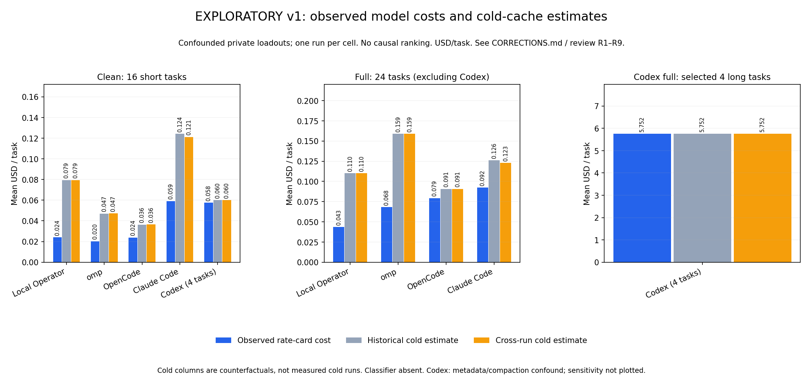
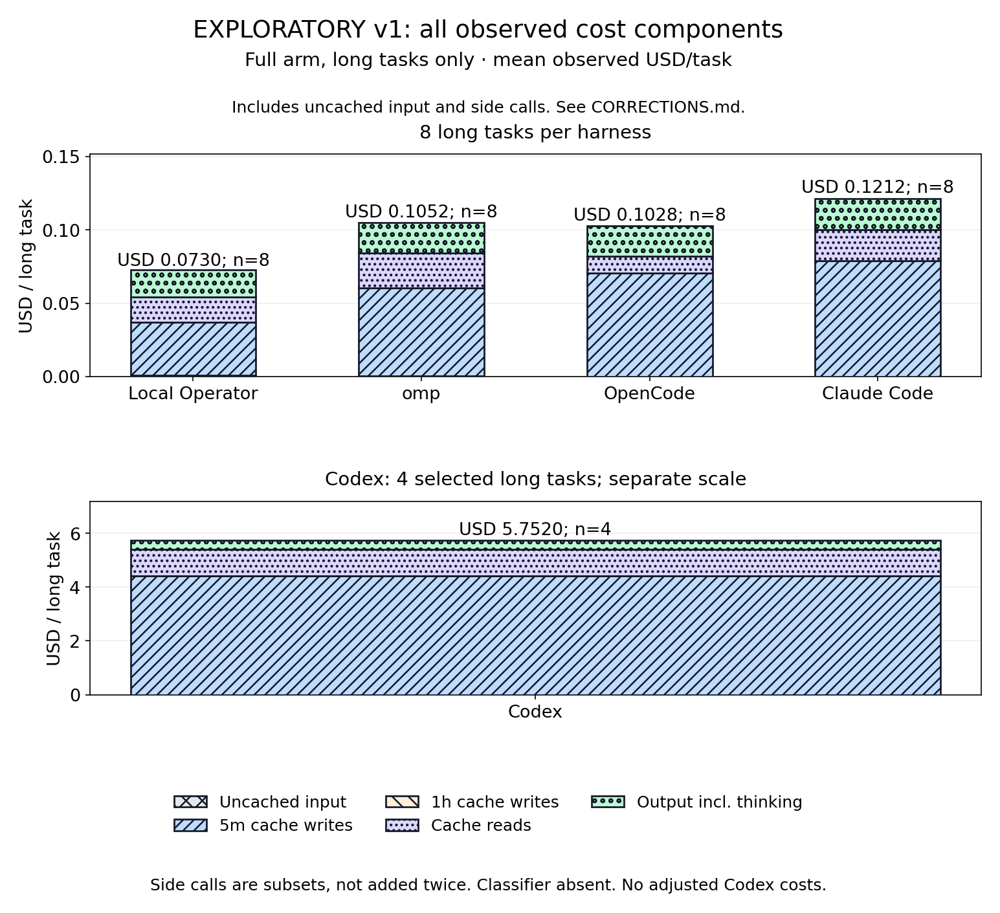

<!-- Moved verbatim from the project README (2026-11-08 README refresh); the README now links here. -->

# Reproducible harness-cost benchmarks

**Inspect the evidence, not just the headline.** The
[public harness-cost kit](../../benchmarks/harness_cost/README.md) includes metered
request records, task and run manifests, pricing calculations, independent
methodology review, and a single command that regenerates the tables and plots.
It also builds a checksummed ZIP for independent review.

> **Exploratory results—not a current-performance ranking.** The initial study
> used unequal private loadouts and uncontrolled cross-run cache warmth; Codex
> also used incorrect model metadata. Those confounds are documented in the
> [corrections](../../benchmarks/harness_cost/CORRECTIONS.md). These results do not
> establish equal task effectiveness or a general cost advantage. Expanded,
> public-loadout experiments must clear their methodology and reproducibility
> gates before any new claim is published. This is not a promotional benchmark:
> the kit states that its author develops Local Operator.

**Exploratory full-loadout sample — the same 24 tasks, one run per task.**
Costs below are USD per task. The cold column is a counterfactual estimate,
not a measured cold run. Logged passes do not establish equivalent effectiveness.

| Harness | Observed USD/task | Historical cold estimate USD/task | Passed / tasks |
|---|---:|---:|---:|
| Local Operator | $0.043441 | $0.110046 | 16 / 24 |
| omp | $0.068227 | $0.158845 | 17 / 24 |
| OpenCode | $0.079233 | $0.090708 | 17 / 24 |
| Claude Code | $0.092382 | $0.125941 | 14 / 24 |

**Separate population:** Codex's full-loadout pilot covered only four selected
long tasks (3 / 4 passed; observed $5.752039 per task), with an incorrect model
catalog and repeated compaction. It is not a valid current-performance
comparison. The [complete accessible tables](../../benchmarks/harness_cost/generated/cost-per-task-table.md)
include all populations, both cold estimates, and the same figures' data.
The figure below opens with the separate **clean 16-task** arm, where Local
Operator ranks third of five on observed cost and fourth on the historical cold
estimate; that arm is the smaller, cleaner comparison, and this table's full-arm
row is not a ranking.

  

What contributes to cost, and how to reproduce the figures

  

From `benchmarks/harness_cost/`, install the pinned analysis dependencies and run
`python regenerate.py`. Regeneration uses the included snapshot only: no model
calls, login, or API spend. See the [reproduction evidence](../../benchmarks/harness_cost/REPRODUCTION.md)
for fresh-extraction checks and the [kit README](../../benchmarks/harness_cost/README.md)
for the exact commands, populations, limitations, and packaging instructions.

