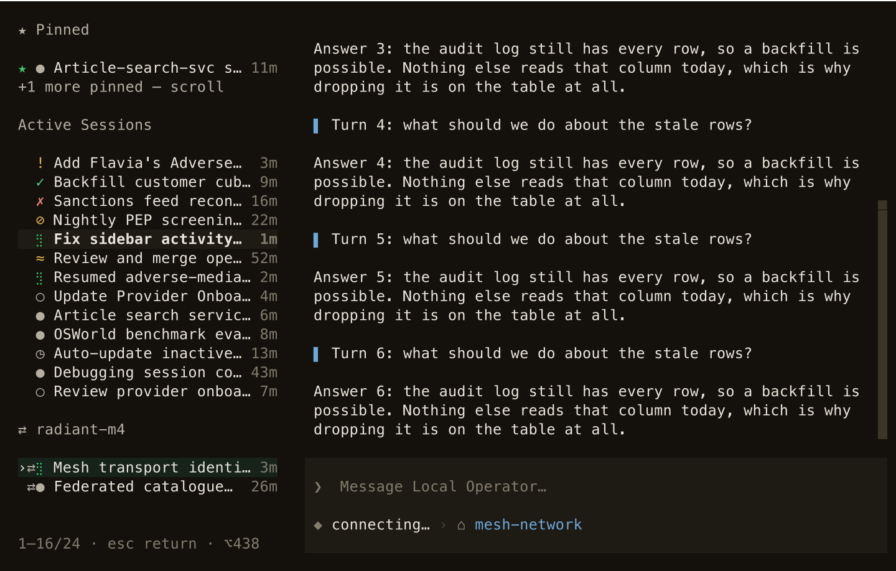
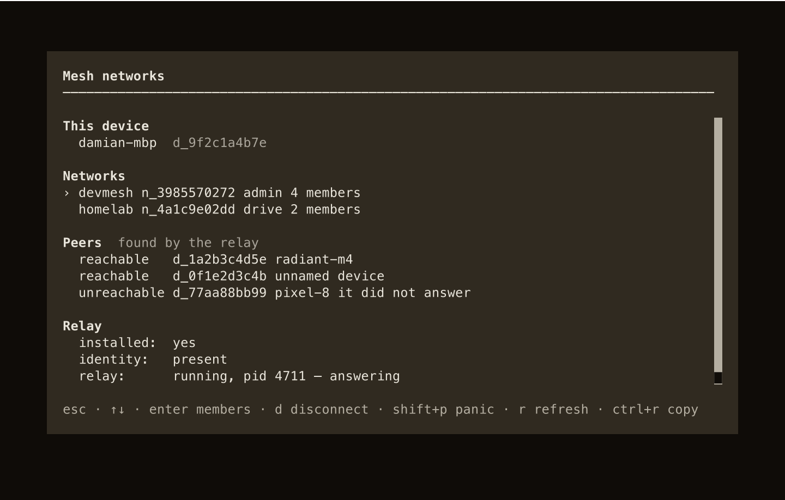
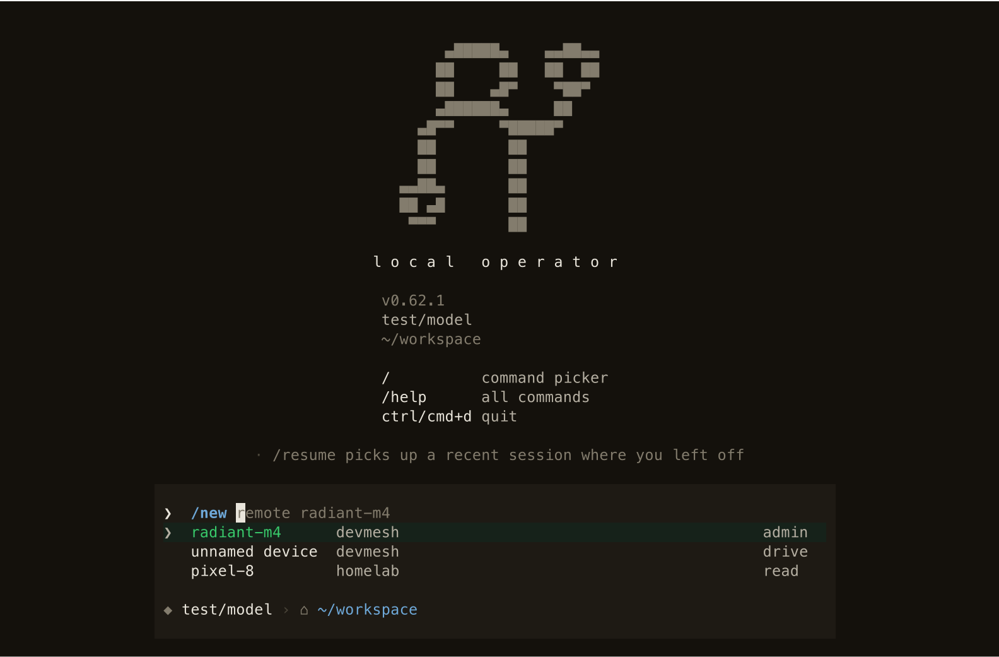
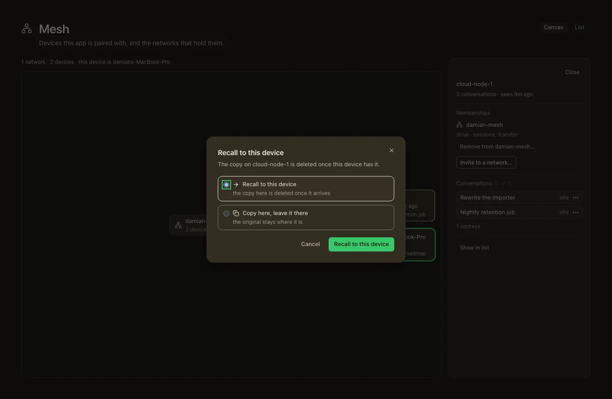
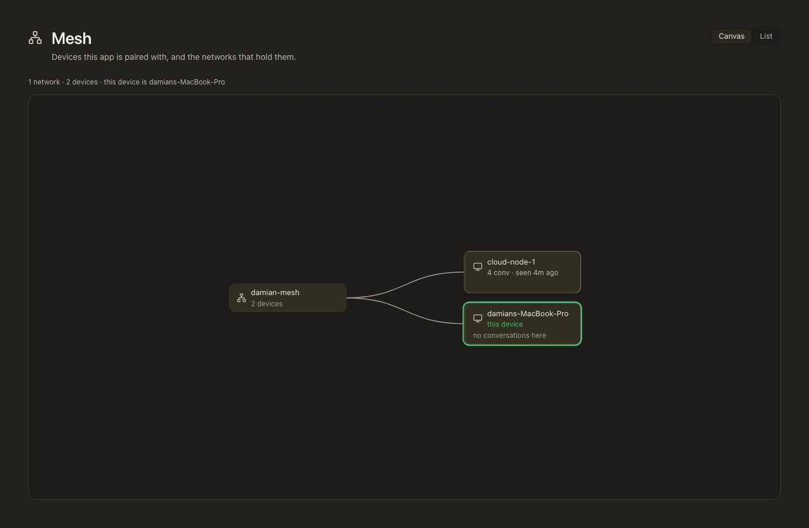

<!-- Moved verbatim from the project README (2026-11-08 README refresh); the README now links here. -->

# Agent Mesh (your own devices)

`lop network` pairs your machines into a **mesh**: a group of devices that trust
each other by a shared secret, each with a keypair of its own. Pair once, and
the sessions running on those devices become one list you can read and act on
from any of them — the desktop you work at, the laptop upstairs, the small box
in the cupboard. Another device's sessions appear in the sidebar under their own
heading, marked `⇄`, and you can start, list, warm or stop a session on a peer
without leaving the machine you are sitting at.

The mesh is peer-to-peer: your devices dial each other directly, with no service
in the middle, and the relay that coordinates them runs on your own machine
(under a LaunchAgent on macOS). The trust boundary is the network itself — a
device you paired — and pairing is a single-use token plus a code two people
compare on two screens.

<p align="center">
  
</p>

<p align="center"><i>A device in a mesh: another machine's <b>running</b> sessions carry the <code>⇄</code> mark and group under it, beside this device's own pinned and active sessions. Captured from a real two-device mesh — the rows come from the peer's own listing, over a live link, not from a fixture.</i></p>

<p align="center">
  
</p>

<p align="center"><i><code>/network</code>: this device, the networks it is in, which peers answer, and whether the relay is running.</i></p>

**Getting started.** On the device that should own the network:

```bash
lop network init devmesh                 # create the network, mint this device's identity, start the relay
lop network invite --role drive          # a single-use token, written to a file, never printed into a pipe
```

It prints where the token went; hand that file to the other device out of band
and, there:

```bash
lop network join @/path/to/token         # both devices show a code; a person compares them, then confirms
lop network status                       # installed, identity, relay, and this device's links
lop network ls                           # devmesh  n_2bf6b70bd36b1cca228daa9f  epoch 1  admin  1 member(s)  active
```

`invite --print` reads the token straight off a terminal when you would rather
copy it than move a file. Roles are `read`, `drive` and `admin`; a token can be
bound to one device and given a shorter life. The pairing *did* work when
`lop network peers` names the other machine — it is the live answer, not the
stored one — and `lop network doctor` is what to run when a device that should
be there is missing, since it reports reachability, epochs and identity per
link. The full walk-through — including what to do when a device is
unreachable, and the incident verbs (`panic`, `disconnect`) — is in the packaged
[network guide](../../local_operator/guides/network/GUIDE.md).

**From inside a session.** The mesh is a slash-command family, so you never
leave the composer:

```text
/network               this device's networks, peers and relay state, as a screen
/network peers         which devices answer right now
/network sessions --all-peers  what other devices are running: list, engage, stop
/network approvals     onboarding cards: list, show, approve, deny
/network status        relay health and the log path
/network log           the recent mesh event trail
```

The pairing verbs are here too — `/network new <name>` creates the network and
`/network invite` mints the token — and on a device that has never paired,
`/network` on its own opens a screen whose empty state names the whole path in
order: create, invite, join. **The joining half is the one step a TUI cannot
host.** Pairing shows a code on each device for a person to check across, so it
runs in a terminal, and `/network join` typed into the composer says exactly
that instead of half-starting a pairing that cannot finish.

**Running a session on another device.** `/new remote` creates the session on
the peer, with a trailing sentence as its first prompt:

```text
/new remote radiant-m4 rebase the auth branch and run the test suite
```

<p align="center">
  
</p>

<p align="center"><i><code>/new</code> lists the devices you paired: the row carries the whole <code>remote &lt;peer&gt;</code> argument, so the first Enter fills a command that runs, and the composer preview always shows exactly what will be sent. The splash's version line is the build this frame was captured from — a development worktree — and not the version of the release this page documents.</i></p>

The session is minted, spawned and admitted by that device, and the receipt in
your transcript names it. `/network sessions --peer radiant-m4` then lists what
that peer is holding, and `--engage <session>` warms one or `--stop <session>`
ends it — so a session started this way is visible and controllable from the
machine you are sitting at, without a second terminal. The same act is one
command from a shell, which is how a script or another agent asks:

```bash
lop network sessions --peer radiant-m4 --create --name "auth rebase" \
  --prompt "rebase the auth branch and run the test suite"
```

The `--prompt` is that session's **first turn**, run there as `--send` would run
it; the receipt says what became of it — completed, failed (with the cause the
turn ended on), or still running. The owner waits up to 45 s for that turn, less
any time spent starting its runtime; a slower one reads `still running on
<device> after N s` with the `--peek` that shows its reply once it arrives.
Only an owner older than this command, which cannot settle a turn at all, gets a
receipt saying it cannot see the end. A
create with no `--prompt` starts no turn at all: it mints the session, warms its
runtime in the background and says so.

Whichever front end starts it, the session is the *peer's*: it appears in that
device's own `lop sessions`, it shows up here under the `⇄` heading for that
device, and piloting it is what piloting a local session is — read the
transcript, send a turn, watch it work.

**Moving a session between devices.** Work that has outgrown the machine it
started on, or work you want back in front of you, moves with its id and its
transcript:

```bash
lop sessions move 9f3ac1e0b7d2 --to build-box          # hand it to the peer; the copy here is retired
lop sessions move 9f3ac1e0b7d2 --to local              # bring a remote one home to this machine
lop sessions move 9f3ac1e0b7d2 --to build-box --keep   # copy it and leave the original running — a new id, marked as a fork
```

The device that will **hold** the conversation is the one that issues the move,
so `--to <peer>` is this machine asking the peer to pull and `--to local` is
this machine pulling; there is no push verb. A session with a turn in flight is
refused rather than interrupted, and `--wait` re-checks a busy one every five
seconds; `--queue` instead records the move to run by itself at the
conversation's next safe point (`lop sessions move --cancel-queued <id>` calls
it off before it starts). Inside the TUI the same act is `/move <id> --to
<peer|local> [--keep] [--queue]`. `lop sessions sync <id>` keeps this machine's
copy of a conversation a peer owns up to date without opening it, and
`lop sessions move <id> --to local --from-replica` recovers that copy as a new
session for when the device that held it is gone.

<p align="center">
  
</p>

<p align="center"><i>Recalling a conversation from a peer, and the <code>--keep</code> distinction in a single dialog: the recall deletes the copy on the device the conversation leaves — the subtitle names it, <code>cloud-node-1</code> — while the other choice copies it and leaves the original running. The tab behind the dialog sits under a scrim (measured: about 40% of its brightness), so the choice is the only live thing on screen. Fixture-driven like the canvas below — the real page over <a href="https://github.com/damianvtran/local-operator-ui">local-operator-ui</a>'s own fixtures, not a live mesh.</i></p>

**Credentials are brokered, not copied.** `lop network credential share
<provider> --with <device>` lets a peer borrow a login *this* device holds, for a
bounded grant (`network.credentials.grant_ttl_s`, fifteen minutes by default),
and `lop network credentials` shows who owns what and what this device borrows.
A refresh belongs to the device that owns the credential — it lends a short-lived
access token and never its refresh token, which is why a token is never refreshed
on a device that does not own it. `kimi` is the one provider that can never be
lent: its grants are signed with the fingerprint of the device that made them.

**The desktop app has its own view of it.**
[`local-operator-ui`](https://github.com/damianvtran/local-operator-ui) mounts a
**Mesh** tab beside the sessions it lists: the networks this device is paired
with, the devices in each, and what each of them is holding. The tab appears once
this device is in a mesh — a device in none shows no Mesh row at all, so pairing
comes first.

<p align="center">
  
</p>

<p align="center"><i>The mesh in the desktop app: the networks this device is paired with, the devices in each, and what each of them is holding. It is also where a move is made by hand — a conversation is dragged from one device's node onto another's, which a still cannot show, and the dialog above is what that drag asks before it commits. From <a href="https://github.com/damianvtran/local-operator-ui">local-operator-ui</a>'s committed Mesh-tab evidence set — the real page over that repository's own fixtures, so the shapes are the backend's and the values are not a live mesh.</i></p>

Nothing above documents a command that does not run today.

The design set behind all of it is in
[`docs/design/mesh-network.md`](../../docs/design/mesh-network.md) — the spine, with
its requirements and, for each one, the document that owns it — alongside
[`mesh-transport-identity.md`](../../docs/design/mesh-transport-identity.md),
[`mesh-session-mobility.md`](../../docs/design/mesh-session-mobility.md),
[`mesh-credentials.md`](../../docs/design/mesh-credentials.md),
[`mesh-incident-response.md`](../../docs/design/mesh-incident-response.md),
[`mesh-compute-pool.md`](../../docs/design/mesh-compute-pool.md) and
[`mesh-ui.md`](../../docs/design/mesh-ui.md).
