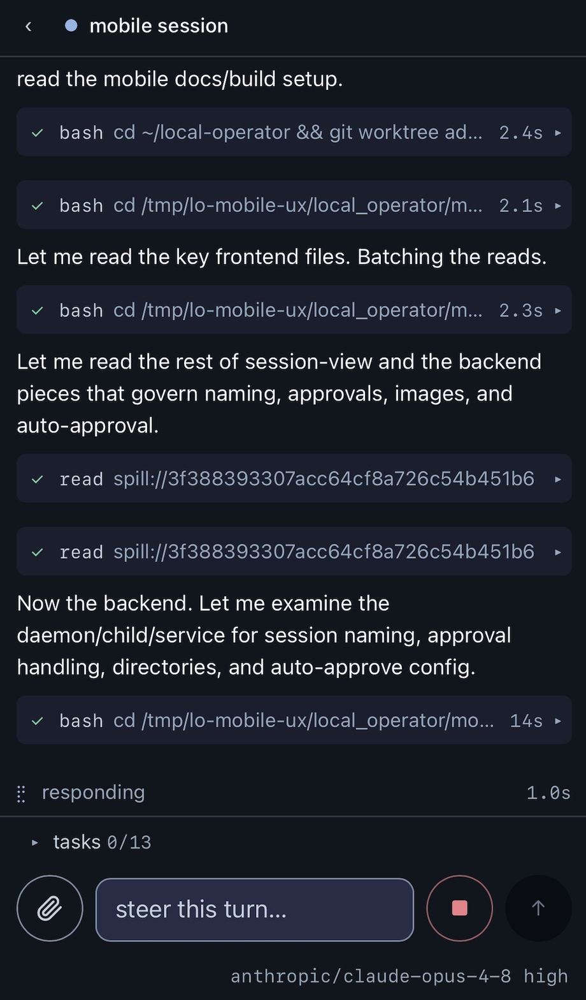

<!-- Moved verbatim from the project README (2026-11-08 README refresh); the README now links here. -->

# Phone Access (Mobile Relay)

`lop mobile` turns the machine you run agents on into a phone-facing control
plane for every `lop` session on it. A single supervised **session daemon**
owns the web surface, and every interactive TUI session registers with it
automatically over an authenticated loopback socket. From your phone you can
watch transcripts stream, steer a running turn, switch model and effort, run
slash commands, drill into subagents, and start brand-new sessions. Sessions
you start from the phone also answer their own approval and ask prompts there;
for a terminal session those prompts are still answered at the terminal (the
phone shows that it is waiting).

<p align="center">
  
</p>

<p align="center"><i>A live <code>lop</code> session driven from a phone: the same transcript, tool cards, and composer as the TUI.</i></p>

**You can ask Local Operator to set this up for you.** Tell the agent
something like *"set up phone access"* and it will walk through the install,
confirm the health check and the closed auth gate, and get you the portal
password through a channel you choose (or leave it in the Keychain for you to
retrieve). If you would rather do it by hand:

```bash
lop mobile install      # generate/keep the portal password, install the daemon, verify health
lop mobile status       # install state, health probe, and registered sessions
lop mobile password     # show or rotate the portal password
lop mobile logs -f      # follow the daemon's and the runtimes' logs
```

Once the daemon is up, every interactive `lop` you start publishes itself and
shows up in the phone list live. No extra flag per session.

## Additional setup is required for remote access

The daemon binds **loopback only** (`127.0.0.1:4098`) and never a wider
address. That keeps it private by construction, so reaching it from your
phone over the internet needs a secure path you put in front of it, together
with an identity proxy so only you can open it.

The **recommended method is a [Cloudflare Tunnel](https://developers.cloudflare.com/cloudflare-one/networks/connectors/cloudflare-tunnel/)**
with Cloudflare Access in front: the tunnel gives the daemon a public
hostname without opening a port on your machine, and Access enforces
sign-in before any request reaches loopback. A WireGuard-based mesh such as
[Tailscale](https://tailscale.com/) is a good alternative if you would rather
keep everything on a private network. Either way, do not change the bind
address to expose the daemon directly; put the tunnel and the identity proxy
in front of the loopback listener instead.

The portal itself is protected by a single password (Keychain-backed on
macOS, or `LOP_MOBILE_PASSWORD` for containers), and session cookies are
derived from it, so rotating the password invalidates every logged-in phone.
