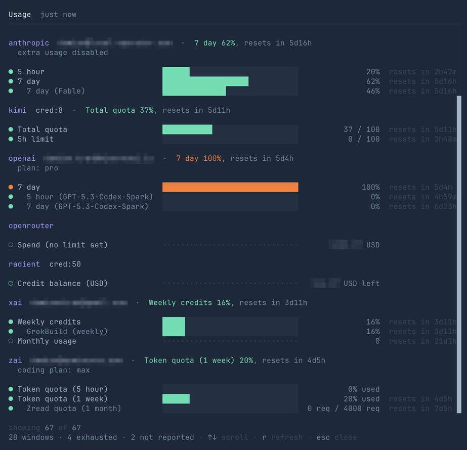

<!-- Moved verbatim from the project README (2026-11-08 README refresh); the README now links here. -->

# Subscriptions

Sign in with the accounts you already have. `lop login` lists every
login-capable provider; the ids and plan requirements:

| You pay for | Type | Plan needed |
| --- | --- | --- |
| ChatGPT | `lop login openai` (`openai-device` on a headless box) | ChatGPT Plus/Pro |
| Claude | `lop login anthropic` | Claude Pro/Max |
| Kimi | `lop login kimi` (international kimi.ai), or `lop login kimi-wechat` (mainland/WeChat kimi.com) | Kimi (Moonshot) |
| Meta Muse Code (unofficial) | `lop login meta-muse` | Active Muse Code plan; [billing/privacy limitations](../../docs/META_MUSE.md) |
| Grok | `lop login xai-oauth` (`xai` = API key) | Grok OAuth |
| Z.AI / GLM | `lop login zai-oauth` (`zai` = API key) | GLM Coding Plan |
| Qwen | `lop login alibaba-token-plan-oauth` | QwenCloud Token Plan (a personal plan also needs the [console ticket](../../local_operator/guides/qwencloud/GUIDE.md) for `/usage`) |

OpenAI, Anthropic, Z.AI, and Qwen logins are keyed by account identity, so a
second login adds to the pool; Kimi holds one account (xAI identity is
best-effort). API keys and local servers sit alongside.

**What this means for you.** With one account per provider, Local Operator
uses that account's plan quota (no API bill) and, when it is rate-limited,
falls back to the next model you listed. With two or more accounts on the
same provider, it spreads your sessions across eligible siblings using cached
quota evidence. A compatible, expiring lease from a successful request keeps a
warm account preferred; after expiry the policy reselects even in the same
conversation. This is a local routing hint, not a guaranteed provider cache hit.

- **Accounts on one provider form a rotation pool.** The default
  `retry.accountSelectionPolicy: reset-soonest` prefers the nearest fresh
  weekly reset, five-hour reset within one-minute ties, then stable spreading.
  Unknown reports stay neutral; ranking makes no extra blocking probes.
  `headroom` and `fair` retain alternative preferences within the same
  credential tier, never cross-provider or paid-tier promotion.
- **Failover follows a fixed order.** On a quota, auth, or 5xx failure the
  request rotates to a sibling account first. Only when the pool is spent
  does it walk your **model fallback chain** (`retry.fallbackChains` in
  `config.yml`), backing off between attempts. `/failovers` prints the
  cascade and marks which account is serving right now.
- **Pinned subagents descend the chain, cross-vendor only as the last
  resort, and say so.** A subagent launched on a resolved model (a role's
  effort tier, or a resumed child) holds that pin until its own model cannot
  serve; the walk then goes family-first and may land on another vendor's
  model, announced on the child's row, the parent's notice and the completion
  record (`pinned X, ran on Y`). The `/settings` row is `Pinned child
  fallback` — **allow cross-vendor** (`cross-family`) by default; **same
  family only** (`same-family`) restores the strict refusal.
- **Success-derived account affinity.** Every policy honors a compatible,
  unexpired local account lease before ranking. Resolve/preflight/inspection
  never renews it; failures, cancellation, empty streams and isolated errands
  do not renew it either. Expiry is request-start plus the actual wire lifetime
  or an explicitly bounded endpoint heuristic. Resume preserves the original
  expiry, not a new lease. Low-but-usable accounts retain a valid lease; hard
  depletion, own failure, incompatibility or expiry can reselect. Changing
  policy leaves unrelated model/effort fallback pins alone.
- **Opt-in proactive switching.** `retry.usageAwareFallback` spends one
  lightweight quota request per user message to leave a provider *before* it
  fails, with `retry.usageReservePercent` (default 10) as the headroom floor.
- **Everything is visible in-app.** `/usage` shows each provider's quota
  windows and account spend; `/accounts` lists every signed-in provider account
  (the `lop secret` store is separate); `/session` reports the current session's
  cost, cache, and request
  diagnostics, and `/session --copy` copies the session ID. One exception:
  QwenCloud's personal Token Plan window needs a
  [console ticket](../../local_operator/guides/qwencloud/GUIDE.md) stored alongside
  the login.

  

The packaged [failover guide](../../local_operator/guides/failover/GUIDE.md)
explains the routing in full, including how to change the order.
