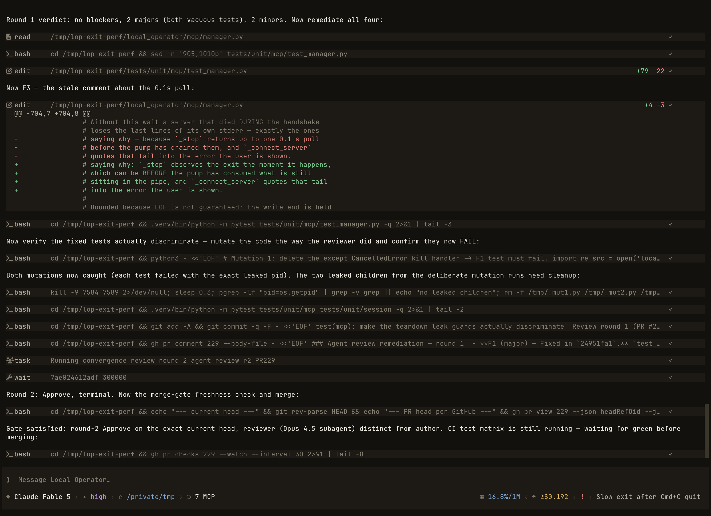
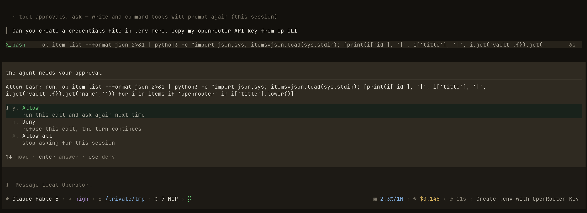
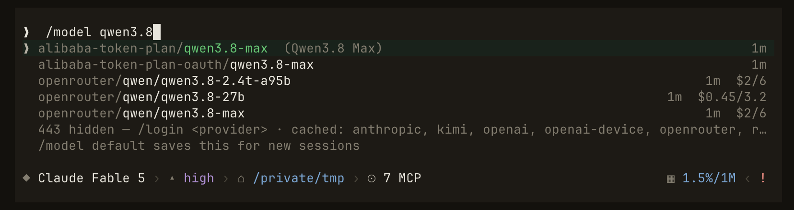
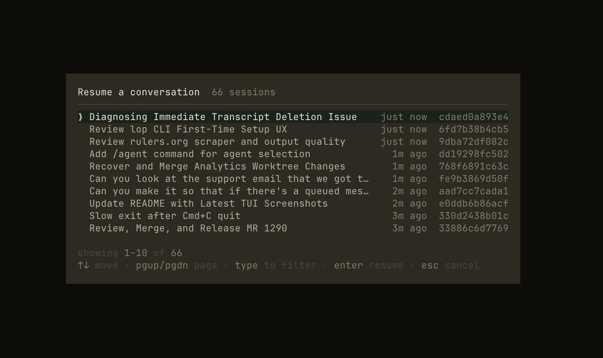

<!-- Moved verbatim from the project README (2026-11-08 README refresh); the README now links here. -->

# A Tour of the Terminal UI (TUI)

The TUI is a full-screen [Textual](https://textual.textualize.io/) app, not a
REPL. Everything the agent does shows up as a card or a one-line receipt: tool
cards expand (`enter`/`space`) to show the full command and output, and the
status line tracks the current step, token usage, and cost. Inside a
terminal multiplexer (tmux, wezterm, [cmux](https://cmux.com/), and others),
`lop` publishes a per-pane crash-restore binding
([multiplexer-resume.md](../../docs/multiplexer-resume.md)) and, in a
[Herdr](https://herdr.dev) Agents panel, reports whether it is idle, working,
or blocked ([herdr-agents.md](../../docs/herdr-agents.md)).

  

<i>One session mid-task: streamed responses, expandable tool cards, and one-line receipts for everything the agent does.</i>

When a tool call needs your sign-off, the approval prompt shows exactly what
is about to run before anything touches your system:

  

Switching models goes through a picker rather than a config file. `/model`
lists every model your signed-in providers offer, with fuzzy filtering.
ChatGPT OAuth uses the account's supported maximum context by default while
keeping the provider default visible;
[context limits and the opt-out](../../docs/openai-context.md) explain how without
changing your compaction settings.

  

Coming back later is `/resume`, a picker over your recent sessions, each
with its title and age:

  

## Slash commands

`/help` shows the full table in-app. The highlights:

| Command | What it does |
| --- | --- |
| `/model` | Switch model for this session; `/model default` saves the current one for new ones, `/model saved` reverts to it (`/settings` edits the boot default too) |
| `/effort` | Show or set reasoning effort (`shift+tab` cycles; save a level for new conversations with `/model default`) |
| `/fast` | Toggle fast mode where the provider sells one: the same answer sooner, at premium pricing |
| `/approvals` | Set whether tools ask first (`ask`/`auto`; add `default` to keep it) |
| `/resume` | Pick a past conversation and continue it |
| `/new`, `/clear`, `/reload` | Fresh conversation · wipe the screen · relaunch this conversation on the current install |
| `/update` | Install the latest version from PyPI and relaunch |
| `/goal <text>` | Set the session objective and send the same text to start work. A judge checks it at each turn end and continues or marks it done. Bare `/goal` opens the goal card (other hosts print a one-line report). `/goal --done` marks it done, `--dismiss` clears a done goal, `--history` lists settled goals, and `--clear` deletes it without a history entry. None of these start a turn (`/goal clear`, `none` and `reset` still work) |
| `/loop` | Iterate autonomously toward the session objective: `/loop <n>` for a bounded count, `/loop <goal>` toward an inline goal; `/loop --stop` cancels a running one and `/loop --clear` clears it — which on a detached owner means dismissing a finished run's published state |
| `/btw` | Ask a side question off the record; it never joins the conversation |
| `/compact` | Compact the context now (it also happens automatically) |
| `/usage`, `/context` | Provider quota and account spend · what's occupying the context window |
| `/session` | Current-session recorded usage, combined cost, cache, and request diagnostics; `/session --copy` copies the session ID to the clipboard |
| `/failovers` | The model cascade for this session, and which account is serving |
| `/provider`, `/login`, `/logout`, `/accounts` | Manage providers and signed-in accounts |
| `/credential` | Hand over a secret: type it after `/credential` and a space to have it masked and captured; a paste your terminal delivers as text is captured the same way; the composer's own paste key (`Ctrl+V` on macOS) is not. Bare `/credential` lists this session's credentials, and `/credential --persist <KEY>` saves one to the long-term store. See [Credentials and secrets](configuration.md#credentials-and-secrets) |
| `/search` | Configure web-search providers and load balancing |
| `/team` | Launch a saved team: `/team <name> <request>`; `/team chart <name>` draws its org chart |
| `/skills`, `/mcp` | List loaded skills · MCP servers |
| `/theme`, `/rename` | Pick from 20+ built-in themes (arrows preview live) · rename the session |

`/reload` and `/update` can replace the terminal while its detached session
runtime keeps working. The new terminal reattaches to the same saved conversation,
including streamed output and unanswered approval or ask prompts. The runtime
adopts installed code only when all work is safely idle: active turns, tools,
compaction, gates, loops, child agents, background jobs, and imminent wakes defer
that refresh. Reloading an unchanged build does not restart the runtime. Local
in-process work and terminal-owned `!` shell commands must finish first. A failed
update leaves the current terminal and runtime running.

## Keys worth knowing

- `$<skill>`: run a named skill on the rest of the line
  (`$research the payments rewrite`); `$` alone opens the picker.
- **Type while the agent works**: your message is delivered at the next
  step as steering, no need to wait.
- `esc` — stop the agent without ending the session.
- `ctrl+b` or `/sidebar` — show or hide active and recent conversations in the
  same TUI. `cmd+b` is also accepted when the terminal forwards the Super
  modifier. `/settings` → **Session sidebar** and **Sidebar position** control
  visibility and left/right placement; the defaults are hidden and left.
  `f9` or `/sidebar focus` opens and focuses the list without changing your
  draft. Arrow keys choose a row, Enter opens it, and Escape returns to the
  previous input surface. F9 also returns focus without hiding a pinned list.
  `ctrl+shift+↑` / `ctrl+shift+↓` switch straight to the previous/next
  conversation in the list's order without opening it, wrapping at the ends;
  the caret and your unsent draft stay where they were.
  On narrow terminals, selecting a conversation dismisses the overlay drawer.
- `f8` — open an aside (side question) without losing what you were typing;
  `ctrl+f` promotes the aside into the conversation.
- `shift+tab`: cycle reasoning effort.
- `ctrl+l`: clear the transcript (history is untouched).
- `ctrl+t` / `ctrl+g`: expand the todo list · cycle the subagent panel.
- **Hand over a secret**: `/credential` followed by a space opens a masked
  capture: type the value and **Enter** turns it into a chip, and a paste your
  terminal delivers as text (`Cmd+V` on macOS) is captured the same way. The
  composer's own paste key (`Ctrl+V` on macOS) never consults the capture: it
  reads the clipboard itself, so it inserts the value as ordinary text.
- `option+←` / `option+→` (`ctrl+←` / `ctrl+→` on Linux and Windows): move the
  caret a word at a time in the composer; add `shift` to select by word. Works
  the same in shell (`!`) mode and with a command list open, and `option+↑` /
  `option+↓` behave as plain `↑` / `↓`. On macOS this works whichever
  option-key mode your terminal is set to. The default, "Use Option as Meta",
  and "Esc+" all behave the same, so there is nothing to configure.
